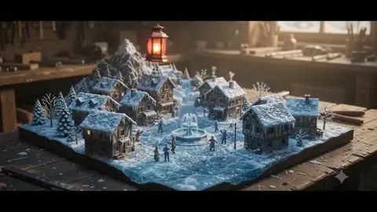

# Giant Hand Thawing a Frozen Miniature Town — by @Fujimoto_hina

[← Back to Community Examples](../../EXAMPLES.md) · Category: Video · Model: `Veo 3.0`

<a href="https://x.com/Fujimoto_hina/status/2125596543457923093"></a>

**[▶ Watch the full video on X](https://x.com/Fujimoto_hina/status/2125596543457923093)** — the preview above is a short silent clip.

Source: **[@Fujimoto_hina on X](https://x.com/Fujimoto_hina/status/2125596543457923093)** · Creator: [Aegon](https://x.com/Fujimoto_hina)

## Prompt

```text
{
  "prompt": "Ultra-photorealistic cinematic miniature diorama video, 16:9 widescreen, 10 seconds, macro tilt-shift photography, shallow depth of field, 4K detail. Everything looks like a real handcrafted physical model with believable scale, realistic textures, and natural physics. A giant realistic human hand works on a wooden workshop table in warm golden window light. 0-2s (Hook): A tiny miniature mountain town is completely frozen in blue ice, with frosted rooftops, frozen fountains, and tiny villagers stuck mid-step like statues. The giant hand enters holding a small glowing red lantern. It touches the ice, creating a ripple of warm orange light that cracks outward across the street. 2-4s: Warmth spreads through the town like a wave. Ice melts from rooftops, chimneys begin puffing smoke, windows glow yellow, and frozen villagers come back to life, laughing and hugging. Fast cinematic push-in. 4-6s: The hand raises the lantern above the mountain. Snow slides from the peaks, meltwater streams through the streets, green grass emerges through the snow, and pink blossoms rapidly bloom on the trees. 6-8s: The camera glides at street level through the thawed town, passing steaming bakeries, children splashing in puddles, and a tiny train rolling out of a mountain tunnel. Soft bokeh and drifting warm light particles. 8-10s (Payoff): The giant hand carries the glowing lantern toward a second frozen town at the edge of the wooden table. Cut precisely as the warm light is about to touch the ice, creating anticipation for the next scene. Photorealistic miniature world, vivid icy blue contrasted with warm orange and fresh green, realistic skin pores and texture on the hand, seamless hand-to-world interaction, physically believable melting ice and flowing water, cinematic lighting, macro depth of field, satisfying ASMR-style ice cracking and melting sounds, no dialogue, no text, no logos, no watermark.",
  "duration": "10 seconds",
  "aspect_ratio": "16:9",
  "quality": "4K",
  "style": "ultra-photorealistic cinematic miniature diorama",
  "camera": "macro tilt-shift, shallow depth of field, cinematic push-in and street-level tracking",
  "audio": "ASMR-style ice cracking, melting water, subtle village ambience, no dialogue",
  "negative_prompt": "cartoon, CGI-looking plastic, unrealistic physics, distorted hands, extra fingers, deformed people, inconsistent scale, flickering, temporal artifacts, text, subtitles, logos, watermark"
}
```

## Try it

Paste the prompt into **[vinano.ai](https://vinano.ai?utm_source=github&utm_medium=readme&utm_campaign=awesome-image-video-prompts-updating&utm_content=x-page-try)** to generate your own version.

> The video and prompt belong to @Fujimoto_hina ([original post](https://x.com/Fujimoto_hina/status/2125596543457923093)) and are shown here with credit for reference. Creators can ask for changes or removal by opening an issue.
