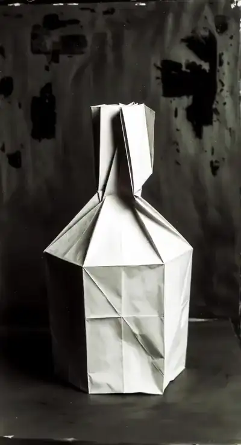

# Rotating Origami Klein Bottle — by @carolletta

[← Back to Community Examples](../../EXAMPLES.md) · Category: Video · Model: `Grok Imagine`

<a href="https://x.com/carolletta/status/2125213120490815626"></a>

**[▶ Watch the full video on X](https://x.com/carolletta/status/2125213120490815626)** — the preview above is a short silent clip.

Source: **[@carolletta on X](https://x.com/carolletta/status/2125213120490815626)** · Creator: [Carolina Delgado](https://x.com/carolletta)

## Prompt

```text
Image prompt:
klein bottle sculpture made of folded white origami paper, crisp creases and facets, the neck curving back into its own body, dark charcoal studio backdrop, random dark illumination, heavy film texture with hasselblad type of shot

Video prompt:
the paper klein bottle slowly rotates a full 360 degrees, light crawls along the crease facets, seamless loop, static camera, soft paper rustle sounds, no music
```

## Try it

Paste the prompt into **[vinano.ai](https://vinano.ai?utm_source=github&utm_medium=readme&utm_campaign=awesome-image-video-prompts-updating&utm_content=x-page-try)** to generate your own version.

> The video and prompt belong to @carolletta ([original post](https://x.com/carolletta/status/2125213120490815626)) and are shown here with credit for reference. Creators can ask for changes or removal by opening an issue.
