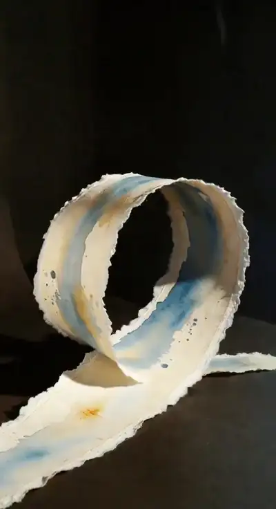

# Watercolour Paper Möbius Strip Loop — by @carolletta

[← Back to Community Examples](../../EXAMPLES.md) · Category: Video · Model: `Grok Imagine`

<a href="https://x.com/carolletta/status/2125575301019398548"></a>

**[▶ Watch the full video on X](https://x.com/carolletta/status/2125575301019398548)** — the preview above is a short silent clip.

Source: **[@carolletta on X](https://x.com/carolletta/status/2125575301019398548)** · Creator: [Carolina Delgado](https://x.com/carolletta)

## Prompt

```text
Image prompt:
mobius strip made of torn watercolour paper in indigo and ochre washes, deckled edges, a single half twist, dark studio backdrop, soft side light, random details, heavy film texture with hasselblad type of shot

Video prompt:
the watercolour mobius strip turns in place while the paper slides endlessly along its single surface, seamless loop, static camera, quiet paper sounds, no music
```

## Try it

Paste the prompt into **[vinano.ai](https://vinano.ai?utm_source=github&utm_medium=readme&utm_campaign=awesome-image-video-prompts-updating&utm_content=x-page-try)** to generate your own version.

> The video and prompt belong to @carolletta ([original post](https://x.com/carolletta/status/2125575301019398548)) and are shown here with credit for reference. Creators can ask for changes or removal by opening an issue.
