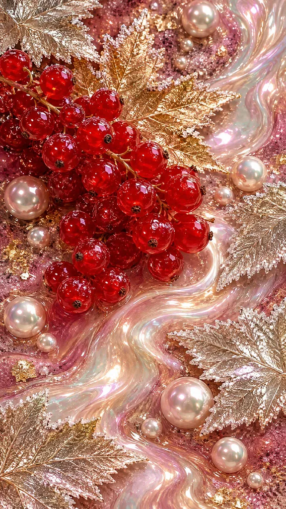

# Frosted Redcurrant Luxury Macro Still Life — by @churvikv

[← Back to Community Examples](../../EXAMPLES.md) · Category: Food & Drink · Model: `GPT Image 2.5 Flare`

<a href="https://x.com/churvikv/status/2125960781292327167"></a>

Source: **[@churvikv on X](https://x.com/churvikv/status/2125960781292327167)** · Creator: [Viki](https://x.com/churvikv)

## Prompt

```text
Photorealistic luxury macro still life, tall 9:16 vertical composition, top-down flat lay, extreme close focus. CRITICAL: one single surface treatment shared by every element — the same gloss, the same sugar crystal frost, the same wet mirror highlights, the same rose-mauve palette. Full bleed, no text, no frame, no border.
BASE SURFACE: a swirling pour of liquid mother-of-pearl. A wide ribbon of highly iridescent fluid, pearl white shading through pale gold, blush pink and cyan opal shimmer, flows diagonally from the top right to the lower left across a marbled rose-mauve and dusty pink ground. That ground is grainy and sugar-crusted, dense with tiny glittering crystals, fine dark speckles and scattered flakes of gold leaf. Soft wet highlights and mirror-bright reflections travel along the pearly ribbon.
FROST LEAVES: large ornate metallic leaves arranged as a loose border, each cold silver-white or pale gold with every vein and serrated tooth edged in thick white crystalline frost, as if dipped in fine sugar. They sit top left, mid right, lower right and bottom left, overlapping the pearly ribbon.
PEARLS: lustrous pearls in pearl-white with rose and green orient, large and small, scattered loosely among the leaves and nestled in the swirls, softly mirrored in the wet surface.
HERO PROPS, centre and upper left, and ONLY these: a heavy cluster of glossy scarlet redcurrant berries on fine brown stems, their skins lacquered and mirror-bright with tiny dark blossom dots, resting against a frosted gold maple leaf. No cinnamon, no blueberries, no blackberries, no star anise anywhere in frame.
TEXTURE: glossy lacquered berries, crystalline frosted leaf edges, gold leaf flecks, wet reflective sheen, ultra-fine macro detail, shallow depth of field, jewel-like, festive.
```

## Try it

Paste the prompt into **[vinano.ai](https://vinano.ai?utm_source=github&utm_medium=readme&utm_campaign=awesome-image-video-prompts-updating&utm_content=x-page-try)** to generate your own version.

> The image and prompt belong to @churvikv ([original post](https://x.com/churvikv/status/2125960781292327167)) and are shown here with credit for reference. Creators can ask for changes or removal by opening an issue.
