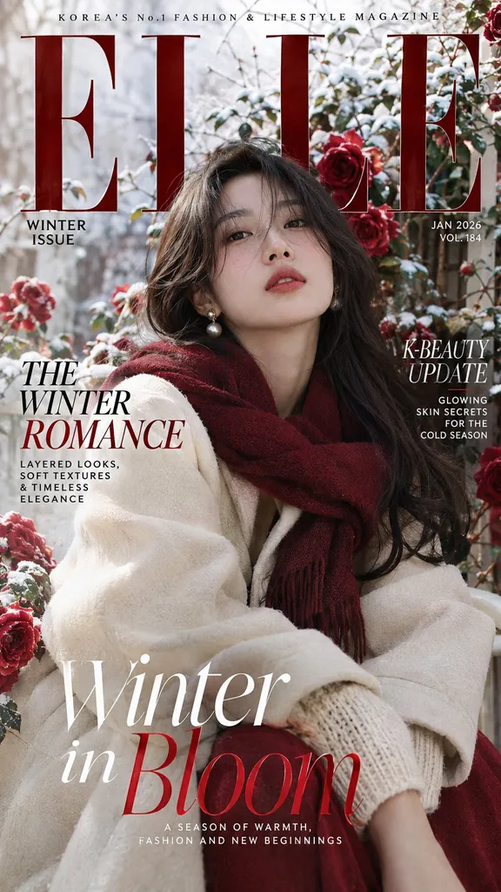

# Korean Fashion Magazine Cover Editorial — by @Goodmanprotocol

[← Back to Community Examples](../../EXAMPLES.md) · Category: Poster Design · Model: `GPT Image 2.6`

<a href="https://x.com/Goodmanprotocol/status/2125825694693564441"></a>

Source: **[@Goodmanprotocol on X](https://x.com/Goodmanprotocol/status/2125825694693564441)** · Creator: [Saul Goodman](https://x.com/Goodmanprotocol)

## Prompt

```text
PREMIUM KOREAN FASHION MAGAZINE COVER | CINEMATIC EDITORIAL PHOTOGRAPHY

Create a stunning, ultra-realistic luxury fashion magazine cover inspired by contemporary Korean fashion editorials. The design should combine professional fashion photography, elegant magazine typography, beautiful seasonal environments, and sophisticated editorial art direction.

1. HERO MODEL & FASHION STYLING

Feature a beautiful, photogenic young adult female model as the main subject. Give her a naturally confident pose, an expressive yet effortless facial expression, realistic skin texture, and professionally styled hair.

Dress her in a carefully coordinated, fashionable outfit that reflects the selected season and editorial concept. Pay close attention to fabric textures, garment structure, accessories, colors, and styling details.

The model should command attention while maintaining a natural, relaxed editorial presence.

2. ENVIRONMENT & SEASONAL CONCEPT

Place the model in a visually captivating real-world environment that complements the fashion story.

Choose an appropriate setting such as a romantic winter garden filled with deep red roses, a charming summer fruit market with colorful produce, or a bright school rooftop beneath a beautiful blue sky.

Build the environment with realistic architectural details, natural vegetation, atmospheric depth, and carefully controlled background elements. The setting should feel like a professionally photographed fashion campaign rather than a digitally constructed backdrop.

3. MAGAZINE MASTHEAD & TYPOGRAPHY

Place a large, oversized luxury magazine title across the upper section of the cover. Use elegant high-contrast serif typography with refined proportions, sophisticated spacing, and a premium editorial appearance.

Allow the model to naturally overlap portions of the magazine title, creating depth and the authentic appearance of a professionally designed fashion publication.

Use complementary typography colors such as crimson red, ivory white, burgundy, or elegant neutral tones.

4. EDITORIAL HEADLINES & COVER DETAILS

Add a selection of beautifully arranged magazine headlines around the model.

Include a prominent seasonal headline, smaller supporting editorial descriptions, and a subtle issue label such as SUMMER ISSUE, WINTER ISSUE, or SCHOOL ISSUE.

Use a combination of sophisticated serif headlines and clean uppercase sans-serif typography. Keep the text balanced and readable without distracting from the main subject.

All text should be correctly spelled, professionally aligned, and integrated naturally into the composition.

5. LIGHTING & PHOTOGRAPHIC QUALITY

Use professional fashion-editorial photography with natural cinematic lighting, realistic shadows, beautifully controlled highlights, and subtle film-inspired color grading.

Capture fine details in the model's hair, skin, clothing, accessories, and surrounding environment. Maintain realistic proportions, natural facial features, and authentic photographic depth.

The final image should have the visual quality of a high-end international fashion magazine photographed by a professional editorial photographer.

6. FINAL ART DIRECTION

Create a visually striking yet sophisticated magazine cover with a strong editorial hierarchy. Balance the oversized masthead, model, seasonal environment, and supporting headlines to achieve a polished, collectible magazine aesthetic.

Visual style: Contemporary Korean fashion editorials, luxury magazine covers, cinematic seasonal photography, sophisticated typography, photorealistic fashion campaigns.

Output: Vertical 9:16 composition, full-bleed photography, premium editorial finish, ultra-realistic details, no watermark, no borders, no social media interface elements.
```

## Try it

Paste the prompt into **[vinano.ai](https://vinano.ai?utm_source=github&utm_medium=readme&utm_campaign=awesome-image-video-prompts-updating&utm_content=x-page-try)** to generate your own version.

> The image and prompt belong to @Goodmanprotocol ([original post](https://x.com/Goodmanprotocol/status/2125825694693564441)) and are shown here with credit for reference. Creators can ask for changes or removal by opening an issue.
