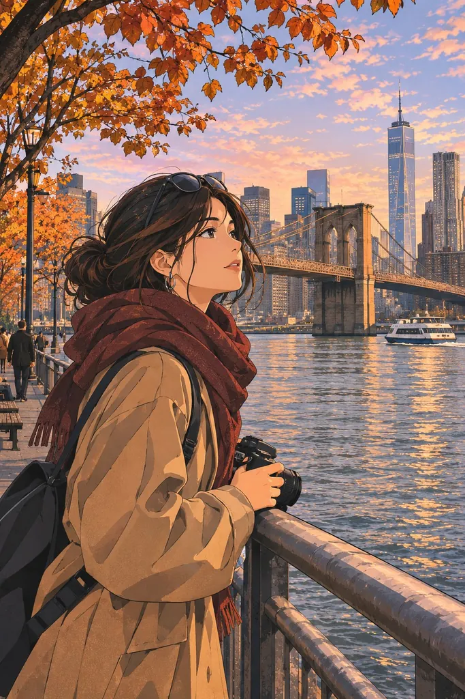

# Japanese Anime Travel Illustration Template — by @Goodmanprotocol

[← Back to Community Examples](../../EXAMPLES.md) · Category: Illustration & 3D · Model: `GPT Image 2.6`

<a href="https://x.com/Goodmanprotocol/status/2126005633980014821"></a>

Source: **[@Goodmanprotocol on X](https://x.com/Goodmanprotocol/status/2126005633980014821)** · Creator: [Saul Goodman](https://x.com/Goodmanprotocol)

## Prompt

```text
JAPANESE ANIME TRAVEL ILLUSTRATION | DESTINATION [DESTINATION]

Create a beautifully detailed Japanese anime-style travel illustration of [Destination], in a vertical 2:3 aspect ratio, full bleed.

Capture a quiet, candid moment during a real journey, featuring an original adult woman in her mid-twenties in the foreground. Make the destination's authentic architecture, streets, or iconic scenery clearly recognizable and equally important to the composition.

Adapt her appearance, hairstyle, natural hair color, clothing, and accessories to the destination, climate, and season. Give her natural facial features, proportionate eyes with restrained highlights, subtle shading, minimal blush, and a relaxed, expressive appearance. Her emotion should feel genuine and understated rather than posed.

Create a natural interaction with the surroundings. She might watch a passing train, admire distant mountains, notice falling snow, explore a local street, or observe a shop window. Use relaxed shoulders, believable body language, natural hand placement, and casual interactions with travel belongings such as a bag, camera, or scarf. Avoid direct eye contact unless it makes sense within the scene.

Use a waist-up or three-quarter composition from eye level or a slightly low viewpoint. Let the woman occupy approximately 35–45% of the frame, preserving generous space for the surrounding scenery. Include a gentle breeze moving a few loose strands of hair.

Preserve the destination's recognizable architectural silhouettes, authentic materials, realistic street proportions, and geographically accurate scenery. Use one believable viewpoint rather than combining unrelated landmarks.

Render everything with refined hand-drawn Japanese anime linework, delicate dark navy contours, elegant layered hair details, and precise, restrained cel shading. Use clean, softly angular shadow shapes and natural skin tones.

Develop a sophisticated color palette inspired by the destination and season, with atmospheric lighting, muted midtones, controlled luminous highlights, and beautiful warm–cool contrasts. Balance intricate environmental details with enough visual breathing room.

Overall mood: Warm, peaceful, observant, and quietly cinematic, like a beautifully illustrated memory from a meaningful journey. Preserve youthful charm through natural expressions, thoughtful composition, and delicate artistic details.

Avoid: Exaggerated sparkling eyes, star-shaped pupils, heavy blush, doll-like proportions, forced smiles, coy poses, idol styling, fantasy clothing, excessive hair accessories, glossy plastic skin, and light-novel cover aesthetics.

Technical restrictions: No photorealism, 3D rendering, airbrushed shading, excessive bloom, glitter effects, text, logos, borders, or watermarks. Generate for new york
```

## Try it

Paste the prompt into **[vinano.ai](https://vinano.ai?utm_source=github&utm_medium=readme&utm_campaign=awesome-image-video-prompts-updating&utm_content=x-page-try)** to generate your own version.

> The image and prompt belong to @Goodmanprotocol ([original post](https://x.com/Goodmanprotocol/status/2126005633980014821)) and are shown here with credit for reference. Creators can ask for changes or removal by opening an issue.
