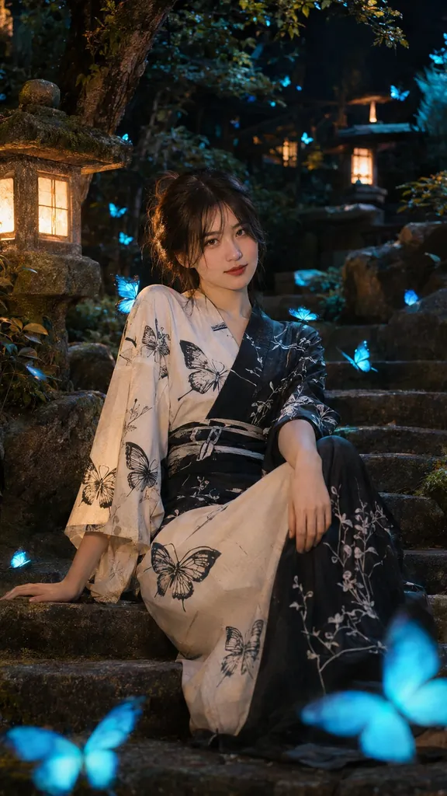

# Blue Butterfly Portrait in a Night Garden — by @Goodmanprotocol

[← Back to Community Examples](../../EXAMPLES.md) · Category: Photography · Model: `GPT Image 2.6`

<a href="https://x.com/Goodmanprotocol/status/2125874450914795819"></a>

Source: **[@Goodmanprotocol on X](https://x.com/Goodmanprotocol/status/2125874450914795819)** · Creator: [Saul Goodman](https://x.com/Goodmanprotocol)

## Prompt

```text
ETHEREAL BLUE BUTTERFLY PORTRAIT | CINEMATIC JAPANESE NIGHT GARDEN PHOTOGRAPHY

Create an ultra-realistic, dreamy cinematic portrait of a beautiful young adult woman sitting gracefully on weathered stone steps in a traditional Japanese garden at night. The atmosphere should feel magical, romantic, and atmospheric, combining authentic low-light portrait photography with subtle fantasy elements.

1. SUBJECT & APPEARANCE

A beautiful young woman with delicate natural facial features, luminous realistic skin, soft red lips, and dark brown hair styled in a loose, slightly messy low bun with wispy face-framing bangs. Her expression is gentle, serene, and slightly mysterious. She looks directly toward the camera with a relaxed, captivating gaze.

2. OUTFIT & STYLING

She wears an elegant traditional Japanese yukata with a distinctive two-tone design:

- One half features an ivory-white fabric with large black butterfly patterns.
- The other half is deep charcoal black with delicate white botanical line patterns.
- Traditional overlapping neckline, wide kimono sleeves, and a neatly tied waist sash.

The fabric should have realistic folds, soft textures, and natural draping.

3. POSE & COMPOSITION

The woman sits naturally on wide, aged stone garden steps, with one knee slightly raised and one hand resting gently on her knee while the other supports her body against the stone surface. Her upper body is slightly angled toward the camera, with her head subtly tilted.

Capture a medium-to-full-body portrait from a slightly low camera angle, creating an intimate editorial composition. Her posture should feel elegant, relaxed, and candid rather than artificially posed.

4. MAGICAL BUTTERFLY EFFECT

Surround her with numerous glowing electric-blue and cyan butterflies of different sizes. Some butterflies gently hover near her face and shoulders, while others rest on her clothing and float through the foreground and background.

Include several large, softly out-of-focus butterflies close to the camera lens to create beautiful depth and dimensionality. Their translucent wings emit a delicate blue bioluminescent glow, illuminating nearby surfaces with subtle cyan reflections.

The butterflies should look detailed, delicate, and naturally integrated into the photograph rather than like artificial graphics.

5. ENVIRONMENT & LIGHTING

Set the scene in a lush Japanese garden at night, featuring:

- Traditional Japanese stone lanterns emitting warm amber light.
- Moss-covered stone steps and natural rocks.
- Dark trees, dense foliage, and subtle garden greenery.
- A softly illuminated background with atmospheric depth.

Create a beautiful contrast between warm golden lantern illumination and cool electric-blue butterfly lighting. Add subtle blue rim lighting around her hair and shoulders, with gentle warm light illuminating her face.

6. CAMERA & PHOTOGRAPHIC STYLE

Professional cinematic portrait photography, shot on an 85mm portrait lens, shallow depth of field, realistic optical bokeh, natural skin texture, detailed fabric rendering, soft highlight roll-off, subtle film grain, and beautifully balanced exposure.

The final image should resemble a high-end Japanese fantasy fashion editorial captured with a professional full-frame camera. Photorealistic, atmospheric, visually rich, and emotionally captivating.

Aspect Ratio: 9:16 vertical portrait.

Quality: Ultra-detailed, photorealistic, cinematic low-light photography, natural anatomy, realistic hands, authentic fabric textures, no artificial CGI appearance, no text, no watermark.
```

## Try it

Paste the prompt into **[vinano.ai](https://vinano.ai?utm_source=github&utm_medium=readme&utm_campaign=awesome-image-video-prompts-updating&utm_content=x-page-try)** to generate your own version.

> The image and prompt belong to @Goodmanprotocol ([original post](https://x.com/Goodmanprotocol/status/2125874450914795819)) and are shown here with credit for reference. Creators can ask for changes or removal by opening an issue.
