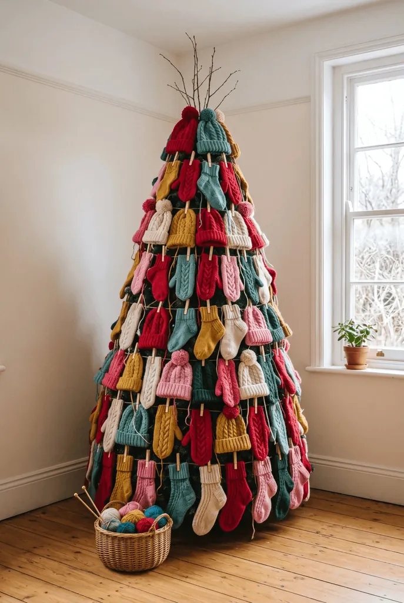

# Hand-Knitted Mitten and Sock Christmas Tree — by @aiartalley

[← Back to Community Examples](../../EXAMPLES.md) · Category: Photography · Model: `Nano Banana 2.1`

<a href="https://x.com/aiartalley/status/2125967990927524329"></a>

Source: **[@aiartalley on X](https://x.com/aiartalley/status/2125967990927524329)** · Creator: [AI Art Alley](https://x.com/aiartalley)

## Prompt

```text
A photorealistic interior lifestyle photograph, taken at standing eye height and square to the wall, of a full-size Christmas tree built entirely from hand-knitted woollen things, standing in the corner of a bright, airy room just left of centre. The tree is a tall, dense cone that nearly reaches the ceiling, seen whole from its base on the floorboards to its tip: hundreds of mittens, socks, small bobble hats with pom-poms and short scarf ends layered in overlapping tiers all the way round the cone, each piece held on with a plain wooden clothes-peg, a packed mix of cherry red, mustard, teal, candy pink, cream and forest green with no gaps showing through. The knitting reads as real wool: visible stitches, cable patterns on the mittens, ribbed sock cuffs, a soft fuzz of yarn fibres along every edge, and a few loose yarn tails hanging free between the tiers. A few bare twiggy branches rise from the very top in place of a star. At the foot of the tree sits a round woven basket full of spare yarn balls with two knitting needles pushed into them. Plain warm-white walls and a simple white skirting board surround it, with a strip of calm white wall above the tip and on both sides of the cone, and honey-toned wide wooden floorboards with a soft sheen run toward the viewer. On the right, a tall white-framed sash window shows bare wintry branches softly out of focus outside, and a small green plant in a terracotta pot stands on its sill. Soft, diffused grey-white winter daylight comes in through the window and falls gently away toward the left wall with no hard shadows. The colours are natural and true, the wool saturated against the white room, and everything is in crisp focus from the floor to the tip.
```

## Try it

Paste the prompt into **[vinano.ai](https://vinano.ai?utm_source=github&utm_medium=readme&utm_campaign=awesome-image-video-prompts-updating&utm_content=x-page-try)** to generate your own version.

> The image and prompt belong to @aiartalley ([original post](https://x.com/aiartalley/status/2125967990927524329)) and are shown here with credit for reference. Creators can ask for changes or removal by opening an issue.
