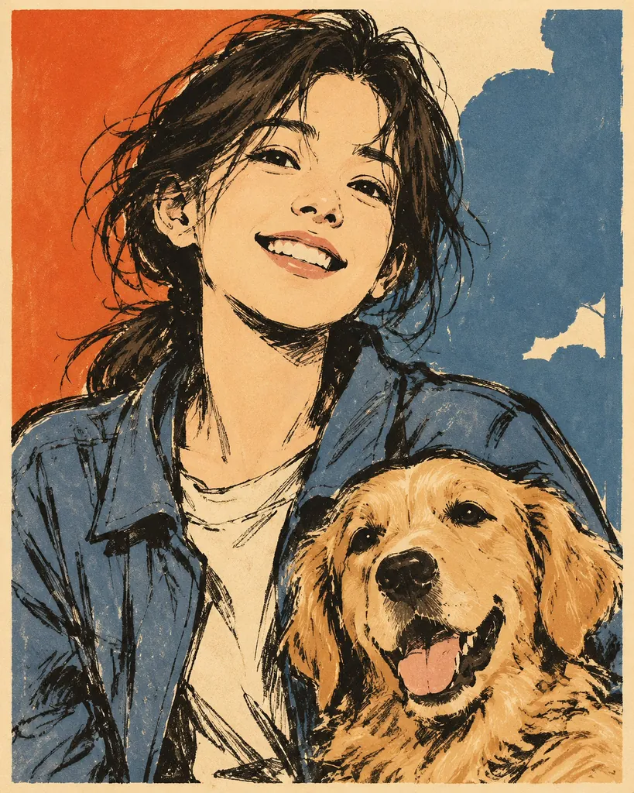

# Raw Sketchy Portrait Poster with a Pet — by @ZDuo_MoreAi

[← Back to Community Examples](../../EXAMPLES.md) · Category: Poster Design · Model: `GPT Image 2.6`

<a href="https://x.com/ZDuo_MoreAi/status/2125907419213771113"></a>

Source: **[@ZDuo_MoreAi on X](https://x.com/ZDuo_MoreAi/status/2125907419213771113)** · Creator: [ZDuo.MoreAi](https://x.com/ZDuo_MoreAi)

## Prompt

```text
Raw sketchy graphic portrait poster of [HUMAN] wearing [CLOTHING], half-body and large in frame, accompanied closely by [ANIMAL], with a minimal [SCENERY] background. Render in a rough expressive illustrated style with broken black ink contours, loose sketch lines, scratchy hatching, irregular stroke weight, imperfect line edges, fast gestural mark-making, simplified anatomy, flat cel-like shadow blocks, and reduced detail. Use a restrained [COLORS] palette with one dominant warm field, one cool counter-field, dark inked shadows, and a few pale highlight accents. Keep the face oversized and central, crop around mid-torso, and place the animal in the lower foreground or tucked beside the subject, drawn with the same simplified raw linework. Reduce the scenery into only 2 or 3 bold silhouette shapes behind the subject, with no detailed environment rendering. Add a narrow warm off-white poster border and very light print texture. Strong attitude, graphic poster energy, intentionally imperfect strokes, raw and sketchy finish, ar 4:5
```

## Try it

Paste the prompt into **[vinano.ai](https://vinano.ai?utm_source=github&utm_medium=readme&utm_campaign=awesome-image-video-prompts-updating&utm_content=x-page-try)** to generate your own version.

> The image and prompt belong to @ZDuo_MoreAi ([original post](https://x.com/ZDuo_MoreAi/status/2125907419213771113)) and are shown here with credit for reference. Creators can ask for changes or removal by opening an issue.
