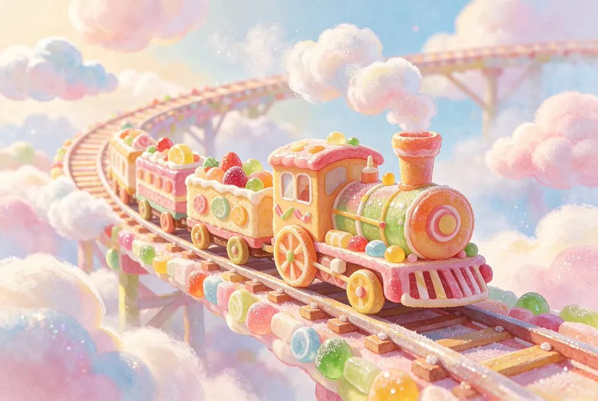

# Candy Train Above the Clouds — by @heathergreen

[← Back to Community Examples](../../EXAMPLES.md) · Category: Illustration & 3D · Model: `Seedream 5.5`

<a href="https://x.com/heathergreen/status/2126133910136639559"></a>

Source: **[@heathergreen on X](https://x.com/heathergreen/status/2126133910136639559)** · Creator: [Heather Green](https://x.com/heathergreen)

## Prompt

```text
Whimsical candy-themed illustration of a train traveling along winding tracks high in the sky, surrounded by fluffy clouds drifting around and above the rails; every element—from the train and tracks to the clouds—is crafted from colorful sugary candy, with glossy, glistening surfaces, sparkling sugar crystals, and playful confectionery details. Dreamy pastel palette, soft luminous sunlight, magical airy atmosphere, wide cinematic composition with rich texture and charming storybook charm.
```

## Try it

Paste the prompt into **[vinano.ai](https://vinano.ai?utm_source=github&utm_medium=readme&utm_campaign=awesome-image-video-prompts-updating&utm_content=x-page-try)** to generate your own version.

> The image and prompt belong to @heathergreen ([original post](https://x.com/heathergreen/status/2126133910136639559)) and are shown here with credit for reference. Creators can ask for changes or removal by opening an issue.
