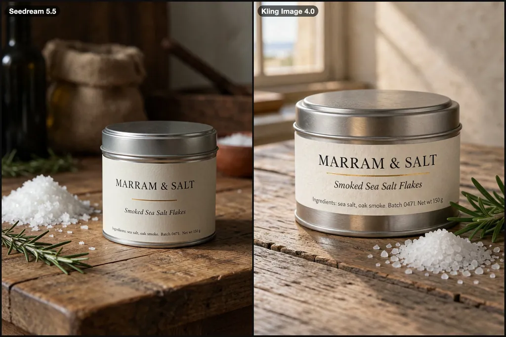

# Sea Salt Tin with Small-Print Label — by @HBCoop_

[← Back to Community Examples](../../EXAMPLES.md) · Category: Product & Brand · Model: `Seedream 5.5`

<a href="https://x.com/HBCoop_/status/2126057699800695091"></a>

Source: **[@HBCoop_ on X](https://x.com/HBCoop_/status/2126057699800695091)** · Creator: [Heather Cooper](https://x.com/HBCoop_)

## Prompt

```text
Commercial product photograph. A round steel tin of sea salt flakes stands on a weathered oak table beside a small pile of salt flakes and a sprig of rosemary, soft morning window light from the left, shallow depth of field. A cream paper label wraps around the tin's curved side and reads, in this order: "MARRAM & SALT" in large black serif capitals with one thin gold line beneath it; "Smoked Sea Salt Flakes" in a smaller black italic serif; and along the bottom edge in small black sans-serif type "Ingredients: sea salt, oak smoke. Batch 0471. Net wt 150 g". Photographic, the label sharp and in focus, true-to-life colour.
```

## Try it

Paste the prompt into **[vinano.ai](https://vinano.ai?utm_source=github&utm_medium=readme&utm_campaign=awesome-image-video-prompts-updating&utm_content=x-page-try)** to generate your own version.

> The image and prompt belong to @HBCoop_ ([original post](https://x.com/HBCoop_/status/2126057699800695091)) and are shown here with credit for reference. Creators can ask for changes or removal by opening an issue.
