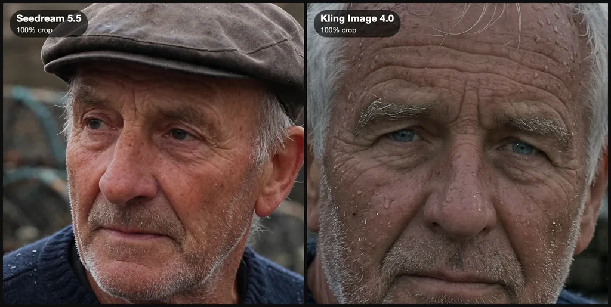

# Weathered Fisherman Portrait at Dawn — by @HBCoop_

[← Back to Community Examples](../../EXAMPLES.md) · Category: Photography · Model: `Seedream 5.5`

<a href="https://x.com/HBCoop_/status/2126057680024510830"></a>

Source: **[@HBCoop_ on X](https://x.com/HBCoop_/status/2126057680024510830)** · Creator: [Heather Cooper](https://x.com/HBCoop_)

## Prompt

```text
Documentary photograph at an overcast dawn on a small harbour quay. A fisherman in his mid-seventies with a deeply weathered face, white stubble, sun spots and fine broken veins on his cheeks, visible pores and deep wrinkles, light drizzle beading on his skin and on the shoulders of a faded navy wool jumper. He looks just past the camera, tired and calm. Soft grey daylight, no flash. Behind him, out of focus, stacked lobster pots and a wet stone harbour wall. 85mm lens at f/2, natural skin with no retouching, fine film grain.
```

## Try it

Paste the prompt into **[vinano.ai](https://vinano.ai?utm_source=github&utm_medium=readme&utm_campaign=awesome-image-video-prompts-updating&utm_content=x-page-try)** to generate your own version.

> The image and prompt belong to @HBCoop_ ([original post](https://x.com/HBCoop_/status/2126057680024510830)) and are shown here with credit for reference. Creators can ask for changes or removal by opening an issue.
