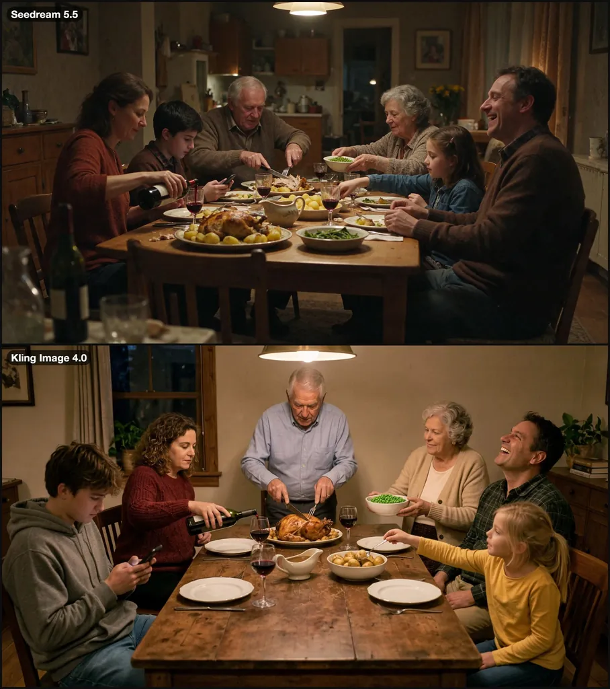

# Six-Person Family Sunday Dinner — by @HBCoop_

[← Back to Community Examples](../../EXAMPLES.md) · Category: Photography · Model: `Seedream 5.5`

<a href="https://x.com/HBCoop_/status/2126057717601329171"></a>

Source: **[@HBCoop_ on X](https://x.com/HBCoop_/status/2126057717601329171)** · Creator: [Heather Cooper](https://x.com/HBCoop_)

## Prompt

```text
Candid documentary photograph of a family Sunday dinner in a warm, slightly cluttered dining room in the evening, lit by a low pendant lamp over the table. Exactly six people sit round a rectangular wooden table set with a roast chicken, potatoes, a gravy jug and glasses of red wine. At the head of the table, a grandfather in his seventies carves the chicken. On the left side, a woman in her forties pours red wine into a glass, and next to her a teenage boy looks down at a phone in his lap. On the right side, a man in his forties laughs with his head tilted back, and next to him a girl of about seven reaches across for a potato. At the far end, a grandmother in her seventies passes a bowl of peas. 35mm lens at eye level, natural colour, soft shadows, fine grain.
```

## Try it

Paste the prompt into **[vinano.ai](https://vinano.ai?utm_source=github&utm_medium=readme&utm_campaign=awesome-image-video-prompts-updating&utm_content=x-page-try)** to generate your own version.

> The image and prompt belong to @HBCoop_ ([original post](https://x.com/HBCoop_/status/2126057717601329171)) and are shown here with credit for reference. Creators can ask for changes or removal by opening an issue.
