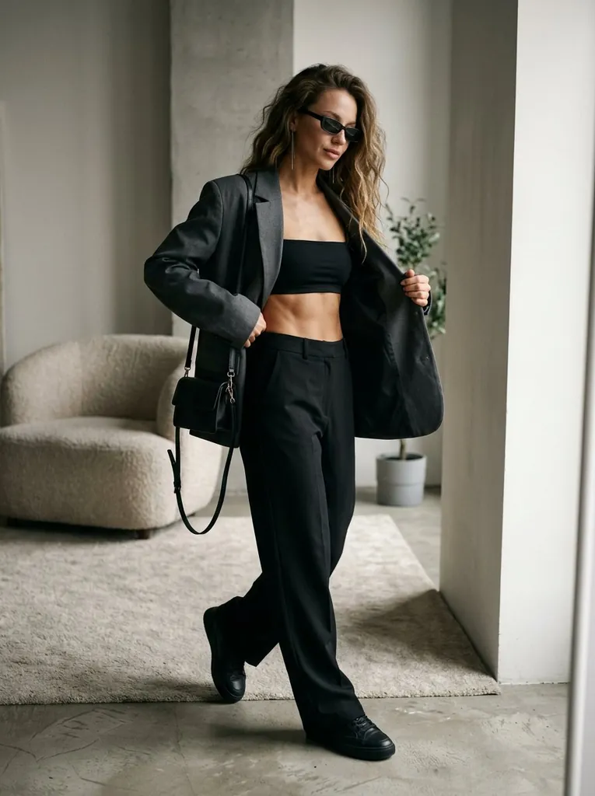

# Minimalist Blazer Lifestyle Photo — by @dreamydigiarts

[← Back to Community Examples](../../EXAMPLES.md) · Category: Photography · Model: `Nano Banana 2`

<a href="https://x.com/dreamydigiarts/status/2125945169904107921"></a>

Source: **[@dreamydigiarts on X](https://x.com/dreamydigiarts/status/2125945169904107921)** · Creator: [dreamy digital arts](https://x.com/dreamydigiarts)

## Prompt

```text
Ultra-realistic lifestyle photo. Woman aged 25–33. Athletic, feminine build. Warm neutral skin tone with natural texture. Confident presence. Setting: minimalist modern interior with concrete floor and soft neutral furniture. Large window off-frame creating directional side light. Subtle shadows on floor and wall. Pose: standing mid-step as if just turning away from the mirror. Weight shifted into one hip. One leg slightly forward. Blazer pulled open with one hand. Small shoulder lift creating asymmetry. Crossbody bag hanging naturally, strap loose. Expression: cool and self-aware. Lips relaxed with a faint half-smirk. Head angled slightly down and to the side. Sunglasses on, but face turned enough to show attitude, not concealment. Hair: long, loose waves, natural volume, slightly undone. Outfit: oversized charcoal blazer, wide-leg tailored trousers, black cropped bandeau top. Clean lines, matte fabric. Pants pooling lightly over shoes. Accessories: slim black sunglasses, long minimal earrings, structured black mini bag. Lighting: soft side window light sculpting abs, collarbones, blazer folds. Gentle contrast. No harsh highlights. Photographic realism. Natural color grading. Shallow depth of field. Subtle grain. Feels like a moment caught mid-motion, not posed.
```

## Try it

Paste the prompt into **[vinano.ai](https://vinano.ai?utm_source=github&utm_medium=readme&utm_campaign=awesome-image-video-prompts-updating&utm_content=x-page-try)** to generate your own version.

> The image and prompt belong to @dreamydigiarts ([original post](https://x.com/dreamydigiarts/status/2125945169904107921)) and are shown here with credit for reference. Creators can ask for changes or removal by opening an issue.
