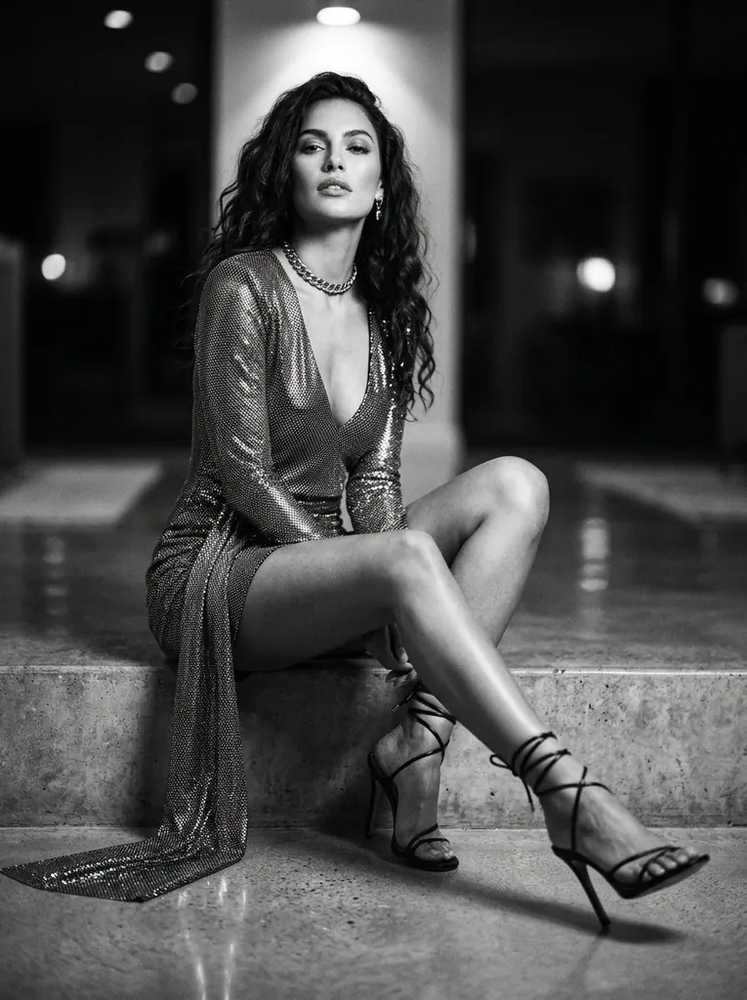

# Black-and-White Glamour Editorial at Night — by @dreamydigiarts

[← Back to Community Examples](../../EXAMPLES.md) · Category: Photography · Model: `Nano Banana 2`

<a href="https://x.com/dreamydigiarts/status/2125907434774434273"></a>

Source: **[@dreamydigiarts on X](https://x.com/dreamydigiarts/status/2125907434774434273)** · Creator: [dreamy digital arts](https://x.com/dreamydigiarts)

## Prompt

```text
High-quality 8k editorial photography, sharp and vibrant, with saturated colors.

A black and white image with a distinctly artistic and glamorous vibe, featuring a woman seated on a polished concrete step inside a modern house at night.

Striking details of the composition:

The central figure and the pose

Pose: The woman sits on the polished concrete step, her long legs extended forward and slightly apart, emphasizing their length and elegance. One leg is bent with her foot resting on the step, while the other remains extended. The lighting highlights the curves of her long, toned legs.

Expression: Her head is tilted slightly back and to the side, looking directly at the camera. Her lips are barely parted, conveying a serene and powerful expression.

Hair: Her hair is dark, voluminous, and wavy, falling freely over her shoulders and framing her face with a few loose, slightly tousled strands.

Clothing and Accessories

Dress: She wears a short, long-sleeved dress made of a metallic or shimmering mesh fabric (a mesh-like material woven with shimmering threads) that reflects light intensely. The dress has a deep V-neck. A strip of the same fabric hangs down one side of the dress, reaching the floor.

Footwear: On her feet, she wears high-heeled stiletto sandals with thin gladiator-style straps that intertwine and tie elegantly around her ankles.

Jewelry: A choker or thick chain is visible around her neck, as well as a small earring dangling from one ear.

Lighting and Setting

Lighting: The main light comes from above and directly in front, highlighting the sheen of the dress fabric, the contours of her legs and arms, and her facial features. There is a strong contrast between the illuminated areas and the deep shadows (chiaroscuro style).

Background: The background is completely out of focus (bokeh), creating a nighttime atmosphere with a few diffused points of light in the distance.
```

## Try it

Paste the prompt into **[vinano.ai](https://vinano.ai?utm_source=github&utm_medium=readme&utm_campaign=awesome-image-video-prompts-updating&utm_content=x-page-try)** to generate your own version.

> The image and prompt belong to @dreamydigiarts ([original post](https://x.com/dreamydigiarts/status/2125907434774434273)) and are shown here with credit for reference. Creators can ask for changes or removal by opening an issue.
