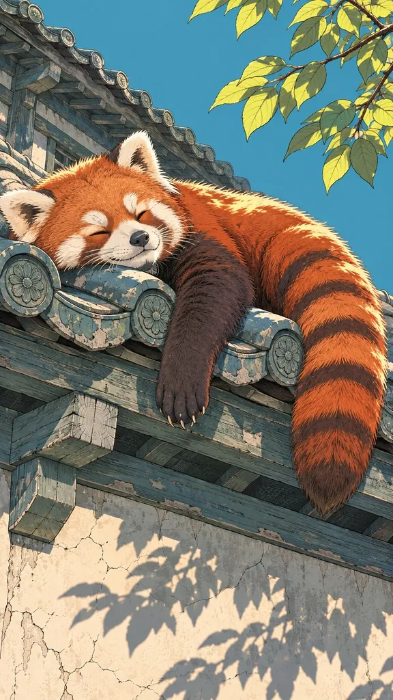

# Fine-Line Red Panda Napping on Roof Tiles — by @static_stare

[← Back to Community Examples](../../EXAMPLES.md) · Category: Illustration & 3D · Model: `GPT Image 2.5`

<a href="https://x.com/static_stare/status/2125855378323960059"></a>

Source: **[@static_stare on X](https://x.com/static_stare/status/2125855378323960059)** · Creator: [mo Ki](https://x.com/static_stare)

## Prompt

```text
Create an image with the following visual system. Replace the subject as specified.

Visual system (light, color, composition, medium, mood):
【画面风格】一张竖幅约 9:16 的日系数字插画，平涂色块加细而密的黑色描线，毛发、木纹、墙面裂纹都用细线一根根勾出来，有一点版画和漫画的感觉，不是厚涂，不是 3D，也不是照片。机位很低，从下往上斜着仰视，一只小动物（由主体决定）趴在一处晒得到太阳的高处睡着了，占画面中间一大块，身体斜着横过画面，眯着眼，表情很舒服，一只前爪软软地从边沿垂下来，落在画面中部偏下的位置。它身下和周围的建筑用青蓝、灰绿这类冷色画，旧旧的，有磨损和斑驳；画面下方约三分之一是一面米白和浅灰的旧墙或石面，有细细的裂纹，上面落着树叶的影子。右上角伸进来一枝浅黄绿色的树叶，叶子一片片用细线勾边，背光处是灰绿。天空是一整块干净的青蓝色，没有云。光是下午偏暖的阳光，从右上方斜照过来，在小动物的背上和亮面留下暖白的高光，阴影是清楚的冷青灰，边缘硬朗。整体配色是青蓝天空、青灰建材、米白墙面作底，小动物是画面里最暖、最饱和的颜色，冷暖对比很抓眼。气氛是懒洋洋、晒得暖烘烘的午后，安静，没有人。画面里不要文字、签名和水印。

New subject:
【主体】一只小熊猫，红棕色的毛、白色的脸颊和眉毛，一条带深色环纹的粗尾巴，趴在一座老宅青蓝色琉璃瓦的屋檐上，尾巴顺着瓦垄垂下来，一只深色的前爪挂在屋檐外面。
```

## Try it

Paste the prompt into **[vinano.ai](https://vinano.ai?utm_source=github&utm_medium=readme&utm_campaign=awesome-image-video-prompts-updating&utm_content=x-page-try)** to generate your own version.

> The image and prompt belong to @static_stare ([original post](https://x.com/static_stare/status/2125855378323960059)) and are shown here with credit for reference. Creators can ask for changes or removal by opening an issue.
