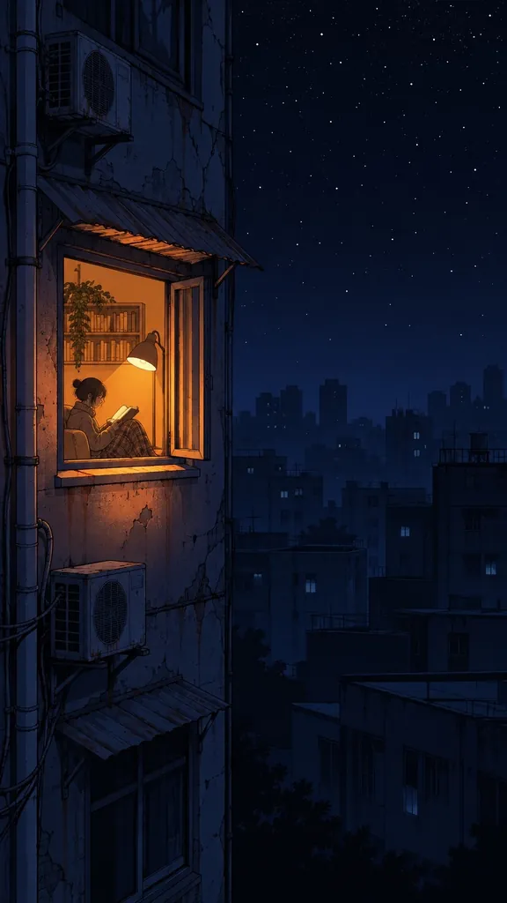

# Last Lit Window in a Blue Night City — by @static_stare

[← Back to Community Examples](../../EXAMPLES.md) · Category: Illustration & 3D · Model: `GPT Image 2.5`

<a href="https://x.com/static_stare/status/2125954639401230445"></a>

Source: **[@static_stare on X](https://x.com/static_stare/status/2125954639401230445)** · Creator: [mo Ki](https://x.com/static_stare)

## Prompt

```text
Create an image with the following visual system. Replace the subject as specified.

Visual system (light, color, composition, medium, mood):
【画面风格】一张竖幅约 9:16 的夜景插画，像漫画分镜里的一格，深色平涂加细细的黑色描线和少量干刷笔触，不是 3D，不是照片。机位在一栋老旧公寓楼外面稍高一点的地方，贴着外墙往下看：画面左半边是这栋楼的外墙，墙面斑驳，有锈迹、裂缝、空调外机、管线和小雨棚；墙上只有一扇窗亮着（窗里是什么由主体决定），位置在画面左侧中上方，窗户半开，里面是饱和的橙黄色暖光，把窗框、雨棚底和窗下一小块墙照亮，窗里的人或动物是一个小小的侧影。画面右半边是往远处层层退去的城市楼群，全部用深蓝和靛蓝画，楼的窗户几乎都是暗的，只零星有几格很暗的灯；楼群上方是深夜的天，从墨蓝渐变到近黑，撒满大小不一的细小白色星点。除了那扇窗，其余一切都是深蓝、靛蓝、蓝黑，暗部几乎是黑色；那扇窗的橙黄是全图唯一的暖色，也是最亮的地方，蓝橙对比很强。光源只有窗里的灯，窗外墙面靠近窗户的地方有一圈柔和的橙色余光，离得越远越快沉进蓝里。气氛很静，像整栋楼都睡了，只剩这一扇窗还醒着。画面里不要文字、招牌、签名和水印。

New subject:
【主体】窗里是一个穿宽大毛衣的人，蜷在窗边的小沙发上看书，膝盖上盖着毯子，身后墙上一个小书架，一盏落地灯照着书页。
```

## Try it

Paste the prompt into **[vinano.ai](https://vinano.ai?utm_source=github&utm_medium=readme&utm_campaign=awesome-image-video-prompts-updating&utm_content=x-page-try)** to generate your own version.

> The image and prompt belong to @static_stare ([original post](https://x.com/static_stare/status/2125954639401230445)) and are shown here with credit for reference. Creators can ask for changes or removal by opening an issue.
