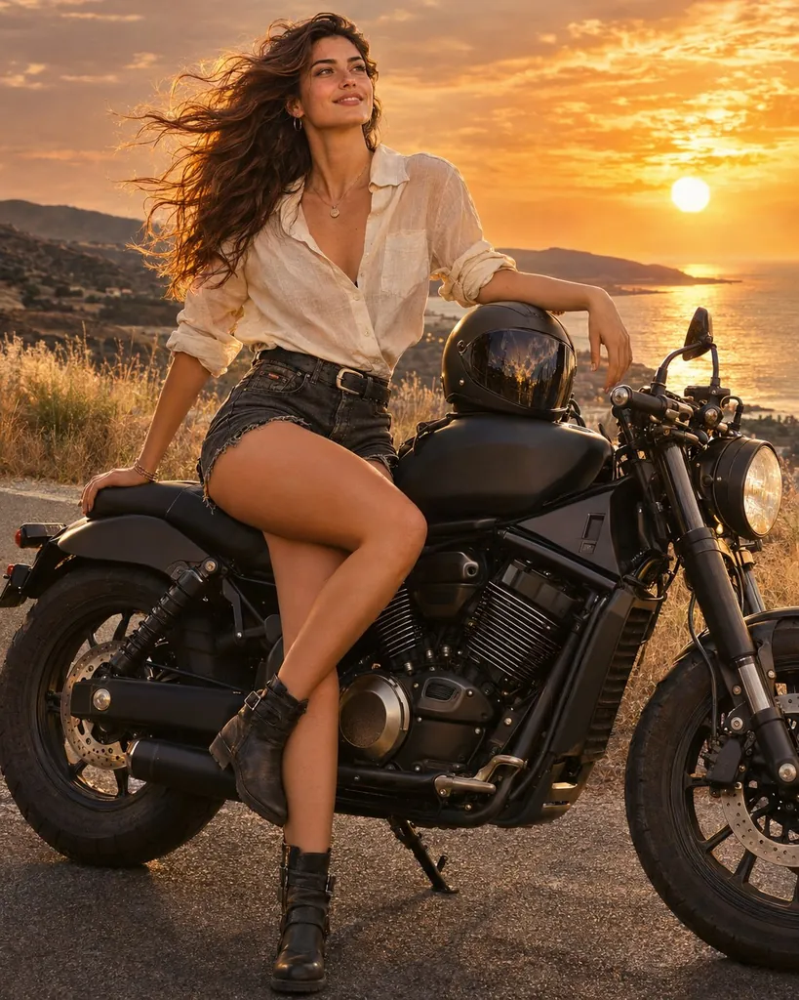

# Golden-Hour Motorcycle Fashion Editorial — by @WanderingC76

[← Back to Community Examples](../../EXAMPLES.md) · Category: Photography · Model: `GPT Image 2.6`

<a href="https://x.com/WanderingC76/status/2126137562742112615"></a>

Source: **[@WanderingC76 on X](https://x.com/WanderingC76/status/2126137562742112615)** · Creator: [Wandering Corner](https://x.com/WanderingC76)

## Prompt

```text
Ultra realistic cinematic golden-hour motorcycle fashion editorial portrait of a beautiful young woman with long, naturally flowing dark chestnut-brown hair swept dramatically by the warm evening breeze, expressive hazel-brown eyes, beautifully defined natural eyebrows, subtle bronze eye makeup, delicate eyeliner, soft peachy lips, a radiant relaxed smile, and luminous natural skin with realistic pores and fine facial texture. Her face is clearly visible, beautifully illuminated, sharply focused, and full of confident free-spirited personality. She sits elegantly on the seat of a powerful matte-black cruiser motorcycle, her body turned slightly sideways, one leg resting naturally along the side of the bike and the other positioned securely near the footrest, creating a relaxed yet bold editorial pose. She gazes toward the glowing horizon with a thoughtful, adventurous expression, her shoulders open and posture self-assured. She wears a lightweight ivory-white button-down blouse with a soft open collar, gently rolled sleeves, delicate natural fabric folds, and a slightly loose fit, paired with high-waisted black denim shorts and rugged black leather ankle boots with subtle buckles and realistic stitching. A sleek matte-black motorcycle helmet with a dark reflective visor rests securely on the fuel tank beside her. The motorcycle features a muscular black frame, sculpted fuel tank, exposed mechanical details, thick tires, a round headlamp, metal handlebars, polished engine components, and realistic subtle reflections across its dark finish. The setting is a quiet coastal road overlooking a golden sea, with rugged dry grasses, distant rolling hills, a softly glowing shoreline, and a vast open sky illuminated by the setting sun. Warm amber sunlight spreads across the horizon, casting long delicate shadows and creating a beautiful golden rim around her flowing hair and the motorcycle's silhouette. Cinematic soft frontal beauty lighting keeps her face bright and clearly visible, balanced fill light reveals her eyes and natural skin texture, while the background remains slightly darker for elegant separation. Rich saturated golden amber, warm ivory, deep matte black, muted olive grasses, and soft copper highlights create a premium sunset color palette. Full-body vertical composition, slightly low camera angle, woman and motorcycle clearly visible, natural anatomy, realistic hands and fingers, authentic motorcycle structure, detailed hair strands, realistic denim and leather textures, shallow depth of field, subtle atmospheric haze, premium lifestyle motorcycle photography, adventurous feminine confidence, open-road freedom, and timeless cinematic biker glamour, highly detailed, sharp focus, 8k, vertical. No cartoon face, no anime face, no animated face. --ar 4:5
```

## Try it

Paste the prompt into **[vinano.ai](https://vinano.ai?utm_source=github&utm_medium=readme&utm_campaign=awesome-image-video-prompts-updating&utm_content=x-page-try)** to generate your own version.

> The image and prompt belong to @WanderingC76 ([original post](https://x.com/WanderingC76/status/2126137562742112615)) and are shown here with credit for reference. Creators can ask for changes or removal by opening an issue.
