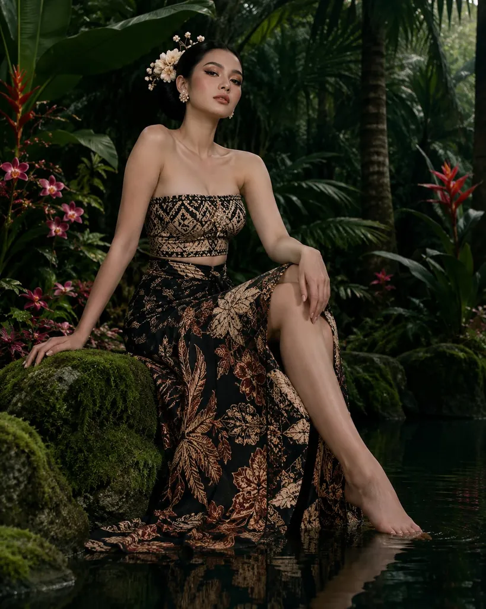

# Batik Fashion Editorial in a Tropical Garden — by @WanderingC76

[← Back to Community Examples](../../EXAMPLES.md) · Category: Photography · Model: `GPT Image 2.6`

<a href="https://x.com/WanderingC76/status/2125873901360308484"></a>

Source: **[@WanderingC76 on X](https://x.com/WanderingC76/status/2125873901360308484)** · Creator: [Wandering Corner](https://x.com/WanderingC76)

## Prompt

```text
A stunning, elegant young woman with a sleek dark updo adorned with delicate floral accessories, wearing a luxurious strapless beige-and-black patterned crop top with intricate geometric details and a flowing black batik-style skirt featuring beautiful earthy floral and leaf patterns. She accessorizes with elegant floral earrings and glamorous makeup featuring warm bronze eyeshadow, defined eyeliner, rosy blush, and nude lips. She poses gracefully while seated on a lush moss-covered rock, one leg elegantly extended toward a dark reflective pond. Surrounded by an enchanting tropical garden filled with oversized banana leaves, palm trees, delicate pink and red flowers, and dense greenery. Deep emerald and black tones, dramatic low-key cinematic lighting, sophisticated luxury fashion editorial photography, mysterious jungle atmosphere, ultra-realistic, exquisite details, professional Vogue photoshoot, 8K quality, vertical 4:5 composition.
```

## Try it

Paste the prompt into **[vinano.ai](https://vinano.ai?utm_source=github&utm_medium=readme&utm_campaign=awesome-image-video-prompts-updating&utm_content=x-page-try)** to generate your own version.

> The image and prompt belong to @WanderingC76 ([original post](https://x.com/WanderingC76/status/2125873901360308484)) and are shown here with credit for reference. Creators can ask for changes or removal by opening an issue.
