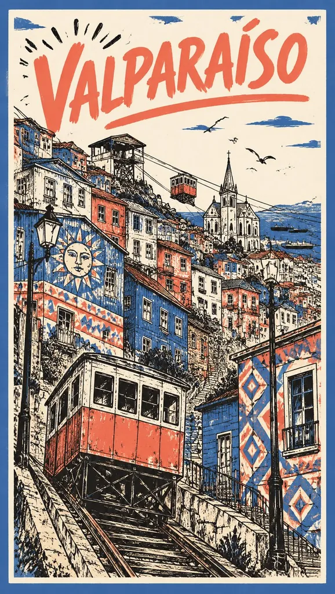

# Valparaiso Vintage Travel Poster — by @Andy4aicreate

[← Back to Community Examples](../../EXAMPLES.md) · Category: Poster Design · Model: `GPT Image 2.6 Flare`

<a href="https://x.com/Andy4aicreate/status/2126019163009286328"></a>

Source: **[@Andy4aicreate on X](https://x.com/Andy4aicreate/status/2126019163009286328)** · Creator: [Andy](https://x.com/Andy4aicreate)

## Prompt

```text
一张魅力十足的复古旅行海报，表现智利的瓦尔帕莱索，采用手绘建筑涂鸦风格。
```

## Try it

Paste the prompt into **[vinano.ai](https://vinano.ai?utm_source=github&utm_medium=readme&utm_campaign=awesome-image-video-prompts-updating&utm_content=x-page-try)** to generate your own version.

> The image and prompt belong to @Andy4aicreate ([original post](https://x.com/Andy4aicreate/status/2126019163009286328)) and are shown here with credit for reference. Creators can ask for changes or removal by opening an issue.
