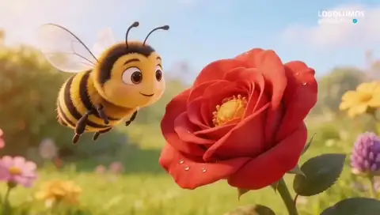

# Curious Bee Discovers a Rose Surprise — by @draavenai

[← Back to Community Examples](../../EXAMPLES.md) · Category: Video · Model: `Seedance 2.0`

<a href="https://x.com/draavenai/status/2125967360893018427"></a>

**[▶ Watch the full video on X](https://x.com/draavenai/status/2125967360893018427)** — the preview above is a short silent clip.

Source: **[@draavenai on X](https://x.com/draavenai/status/2125967360893018427)** · Creator: [Draaven](https://x.com/draavenai)

## Prompt

```text
A heartwarming Pixar-style 3D animated scene in a beautiful sunny flower garden. A tiny adorable fluffy yellow bee with big expressive brown eyes, tiny wings, and a cute striped body flies toward a large vibrant red rose. The bee discovers a tiny creature hiding inside the flower and reacts with surprise and curiosity. The two characters have expressive facial animations and adorable emotional reactions. The bee gently flies around the rose, creating a magical trail of sparkling golden pollen. Soft sunlight, colorful wildflowers, lush green grass, shallow depth of field, cinematic close-ups, smooth camera movement, realistic fluffy textures, charming character animation, whimsical atmosphere, high-quality 3D animation, 4K.
```

## Try it

Paste the prompt into **[vinano.ai](https://vinano.ai?utm_source=github&utm_medium=readme&utm_campaign=awesome-image-video-prompts-updating&utm_content=x-page-try)** to generate your own version.

> The video and prompt belong to @draavenai ([original post](https://x.com/draavenai/status/2125967360893018427)) and are shown here with credit for reference. Creators can ask for changes or removal by opening an issue.
