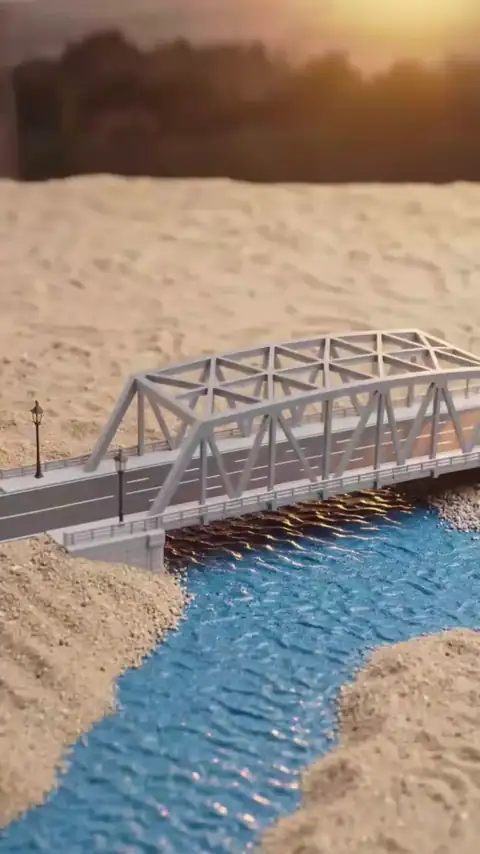

# Miniature Modern Bridge Build Timelapse — by @OliviaRose10un

[← Back to Community Examples](../../EXAMPLES.md) · Category: Video · Model: `Seedance 2.0`

<a href="https://x.com/OliviaRose10un/status/2125822470519472466"></a>

**[▶ Watch the full video on X](https://x.com/OliviaRose10un/status/2125822470519472466)** — the preview above is a short silent clip.

Source: **[@OliviaRose10un on X](https://x.com/OliviaRose10un/status/2125822470519472466)** · Creator: [Olivia Rose](https://x.com/OliviaRose10un)

## Prompt

```text
Watch a stunning miniature modern bridge come to life through realistic DIY construction, precision engineering, satisfying timelapse, and breathtaking cinematic details.
```

## Try it

Paste the prompt into **[vinano.ai](https://vinano.ai?utm_source=github&utm_medium=readme&utm_campaign=awesome-image-video-prompts-updating&utm_content=x-page-try)** to generate your own version.

> The video and prompt belong to @OliviaRose10un ([original post](https://x.com/OliviaRose10un/status/2125822470519472466)) and are shown here with credit for reference. Creators can ask for changes or removal by opening an issue.
