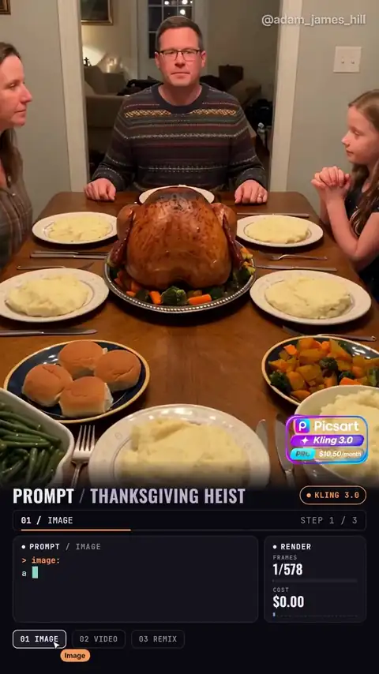

# Cats Steal the Thanksgiving Turkey — by @adam_james_hill

[← Back to Community Examples](../../EXAMPLES.md) · Category: Video · Model: `Kling 3.0`

<a href="https://x.com/adam_james_hill/status/2125996896506253514"></a>

**[▶ Watch the full video on X](https://x.com/adam_james_hill/status/2125996896506253514)** — the preview above is a short silent clip.

Source: **[@adam_james_hill on X](https://x.com/adam_james_hill/status/2125996896506253514)** · Creator: [Adam James Hill](https://x.com/adam_james_hill)

## Prompt

```text
image: a family praying at a thanksgiving table, a roasted turkey in the middle, mashed potatoes and rolls, a fat orange cat sitting on a chair at the end of the table, warm home light, vertical 9:16

video: while the family keeps their eyes closed, three cats lift the turkey platter off the table and carry it out of the room on their hind legs. the dad opens his eyes to an empty spot. 20 seconds
```

## Try it

Paste the prompt into **[vinano.ai](https://vinano.ai?utm_source=github&utm_medium=readme&utm_campaign=awesome-image-video-prompts-updating&utm_content=x-page-try)** to generate your own version.

> The video and prompt belong to @adam_james_hill ([original post](https://x.com/adam_james_hill/status/2125996896506253514)) and are shown here with credit for reference. Creators can ask for changes or removal by opening an issue.
