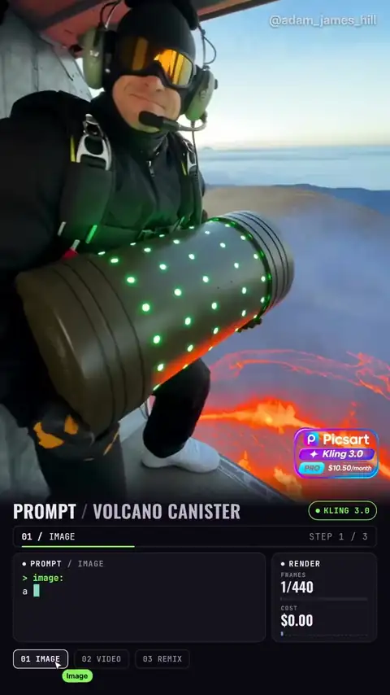

# Glowing Canister Dropped into a Volcano — by @adam_james_hill

[← Back to Community Examples](../../EXAMPLES.md) · Category: Video · Model: `Kling 3.0`

<a href="https://x.com/adam_james_hill/status/2126074178021343737"></a>

**[▶ Watch the full video on X](https://x.com/adam_james_hill/status/2126074178021343737)** — the preview above is a short silent clip.

Source: **[@adam_james_hill on X](https://x.com/adam_james_hill/status/2126074178021343737)** · Creator: [Adam James Hill](https://x.com/adam_james_hill)

## Prompt

```text
image: a man in a headset and goggles standing in the open door of a helicopter over an active lava lake, holding a heavy metal canister covered in green lights, sunrise haze, vertical 9:16

video: he drops the canister into the lava, the crater flashes green and erupts, then a creature with glowing green veins climbs in through the helicopter door. handheld, 15 seconds
```

## Try it

Paste the prompt into **[vinano.ai](https://vinano.ai?utm_source=github&utm_medium=readme&utm_campaign=awesome-image-video-prompts-updating&utm_content=x-page-try)** to generate your own version.

> The video and prompt belong to @adam_james_hill ([original post](https://x.com/adam_james_hill/status/2126074178021343737)) and are shown here with credit for reference. Creators can ask for changes or removal by opening an issue.
