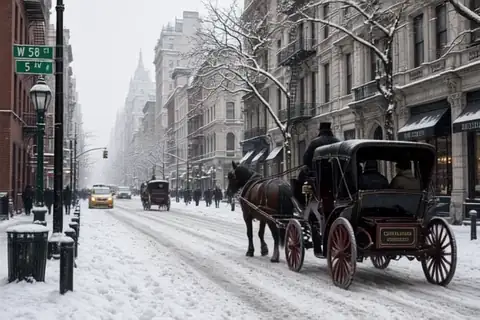

# Snowy New York Street with Horse Carriages — by @SpaceEagle

[← Back to Community Examples](../../EXAMPLES.md) · Category: Video · Model: `Grok Imagine`

<a href="https://x.com/SpaceEagle/status/2126117557950378482"></a>

**[▶ Watch the full video on X](https://x.com/SpaceEagle/status/2126117557950378482)** — the preview above is a short silent clip.

Source: **[@SpaceEagle on X](https://x.com/SpaceEagle/status/2126117557950378482)** · Creator: [Cal Jennings](https://x.com/SpaceEagle)

## Prompt

```text
A New York street with a foot of snow and horse drawn carriages.
```

## Try it

Paste the prompt into **[vinano.ai](https://vinano.ai?utm_source=github&utm_medium=readme&utm_campaign=awesome-image-video-prompts-updating&utm_content=x-page-try)** to generate your own version.

> The video and prompt belong to @SpaceEagle ([original post](https://x.com/SpaceEagle/status/2126117557950378482)) and are shown here with credit for reference. Creators can ask for changes or removal by opening an issue.
