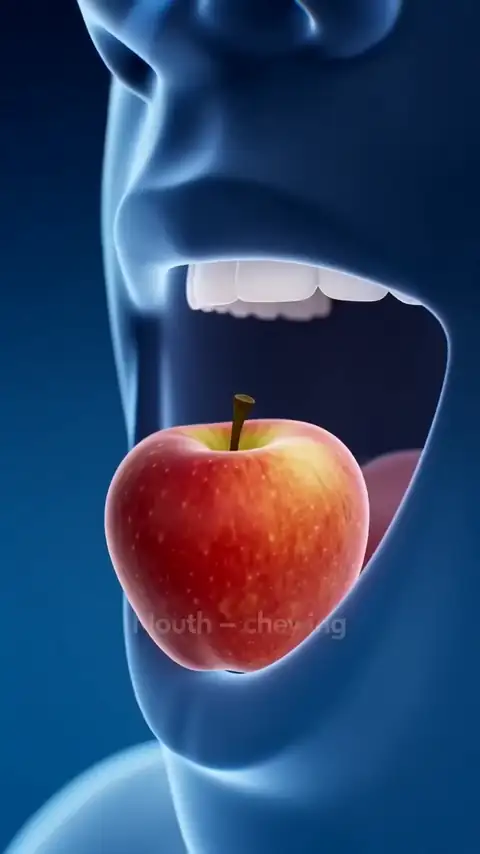

# Digestive System 3D Explainer Animation — by @0xCortiq

[← Back to Community Examples](../../EXAMPLES.md) · Category: Video · Model: `Seedance 2.0`

<a href="https://x.com/0xCortiq/status/2125989462639567046"></a>

**[▶ Watch the full video on X](https://x.com/0xCortiq/status/2125989462639567046)** — the preview above is a short silent clip.

Source: **[@0xCortiq on X](https://x.com/0xCortiq/status/2125989462639567046)** · Creator: [Cortiq](https://x.com/0xCortiq)

## Prompt

```text
15-second educational 3D medical animation, clean and friendly style like a modern science explainer for kids and adults. Semi-transparent human body on a soft dark-blue background, glowing organs, smooth continuous camera following a single piece of food (a bite of an apple) through the digestive system. Bright, clear colors, labels appear briefly next to each organ in simple white text.

0–2s: Close-up of a mouth biting an apple. Teeth chew it, saliva mixes in, the piece turns into a soft round ball (bolus). Label: "Mouth — chewing".

2–4s: The ball slides down the esophagus, wave-like muscle contractions pushing it downward (peristalsis). Label: "Esophagus".

4–7s: Food enters the stomach. Stomach walls squeeze and churn, glowing green gastric acid breaks the food into a thick liquid. Label: "Stomach — acid breaks food down".

7–10s: Liquid moves into the long coiled small intestine. Camera zooms into the inner wall covered with tiny finger-like villi; small glowing nutrient particles pass through the wall into red blood vessels. Liver and pancreas glow briefly, sending digestive juices. Label: "Small intestine — nutrients absorbed into blood".

10–13s: Remaining material moves into the large intestine (colon). Water is absorbed, the mass becomes thicker and darker brown, forming stool. Label: "Large intestine — water absorbed".

13–15s: Stool moves to the rectum and exits the body (shown tastefully, cartoon-like, no realistic details). Final wide shot of the whole digestive tract glowing as one path. Text on screen: "From food to energy — the journey takes 24–72 hours".

Style: Pixar-like 3D medical visualization, educational, not gross, smooth transitions, cinematic lighting, 4K, no blood or graphic realism.
```

## Try it

Paste the prompt into **[vinano.ai](https://vinano.ai?utm_source=github&utm_medium=readme&utm_campaign=awesome-image-video-prompts-updating&utm_content=x-page-try)** to generate your own version.

> The video and prompt belong to @0xCortiq ([original post](https://x.com/0xCortiq/status/2125989462639567046)) and are shown here with credit for reference. Creators can ask for changes or removal by opening an issue.
