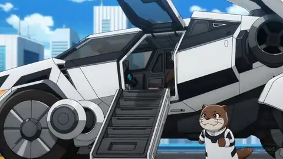

# Otter Pilot Boards a Giant Mecha — by @IABossOfficiel

[← Back to Community Examples](../../EXAMPLES.md) · Category: Video · Model: `Seedance 2.0`

<a href="https://x.com/IABossOfficiel/status/2125865342786269664"></a>

**[▶ Watch the full video on X](https://x.com/IABossOfficiel/status/2125865342786269664)** — the preview above is a short silent clip.

Source: **[@IABossOfficiel on X](https://x.com/IABossOfficiel/status/2125865342786269664)** · Creator: [IA Boss | Astuces ChatGPT &amp; IA](https://x.com/IABossOfficiel)

## Prompt

```text
Mecha anime sequence: an anthropomorphic otter pilot prepares to board a giant combat mech. Shot 1: wide hangar reveal with backlit mech silhouette, steam, and warning beacons. Shot 2: mechanical montage of gears rotating, hydraulics extending, power lines activating, and cockpit hatch unlocking. Shot 3: otter climbs into the cockpit, with close-ups on focused eyes and control gestures. Shot 4: hatch seals, HUD lights up, mech visor ignites, and otter gives a confident thumbs-up. Emphasize dense mechanical detail, coherent machine motion logic, and cinematic anime pacing.
```

## Try it

Paste the prompt into **[vinano.ai](https://vinano.ai?utm_source=github&utm_medium=readme&utm_campaign=awesome-image-video-prompts-updating&utm_content=x-page-try)** to generate your own version.

> The video and prompt belong to @IABossOfficiel ([original post](https://x.com/IABossOfficiel/status/2125865342786269664)) and are shown here with credit for reference. Creators can ask for changes or removal by opening an issue.
