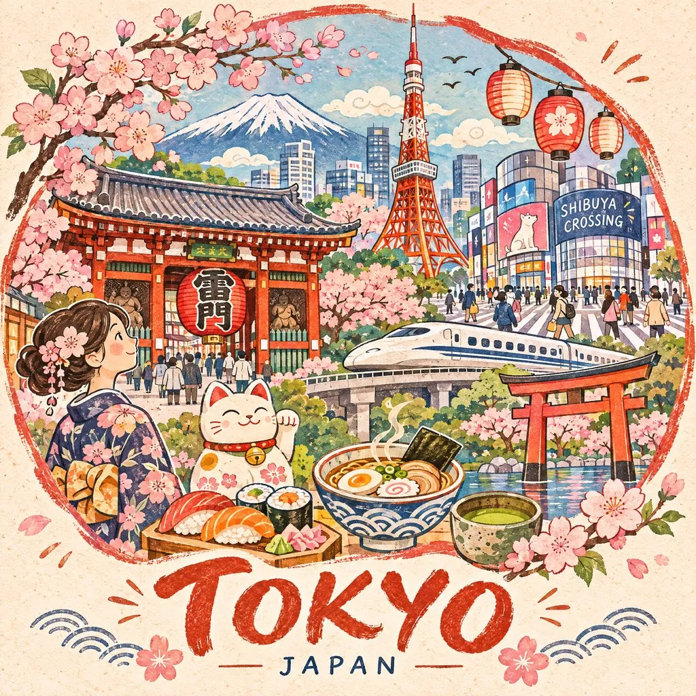

# Whimsical City Travel Illustration Template — by @Naiknelofar788

[← Back to Community Examples](../../EXAMPLES.md) · Category: Illustration & 3D · Model: `GPT Image 2.6`

<a href="https://x.com/Naiknelofar788/status/2126290527549317468"></a>

Source: **[@Naiknelofar788 on X](https://x.com/Naiknelofar788/status/2126290527549317468)** · Creator: [simeon-sanai](https://x.com/Naiknelofar788)

## Prompt

```text
Create an exceptionally charming, whimsical travel illustration featuring [CITY NAME], [COUNTRY], in a playful hand-drawn editorial illustration style.

1. CENTRAL COMPOSITION

Create a large, irregular circular or organic-shaped illustrated window in the centre of the canvas.

Inside this window, bring together the destination’s most iconic landmarks, architecture, transportation and cultural identity in one beautiful miniature travel scene.

The composition should feel like a little illustrated world full of stories and discoveries.

2. ICONIC LANDMARKS

Feature 1–3 recognisable landmarks of the destination.

Preserve their authentic architectural silhouettes and distinctive details while simplifying them into charming hand-drawn illustrations.

3. LOCAL CULTURAL ELEMENTS

Include 2–4 colourful objects representing everyday life and local culture, such as:

Traditional food and drinks.
Local transportation, buses, trains, bicycles or boats.
Traditional clothing or cultural objects.
Famous local street-life elements.
Small symbols associated with the destination.

Arrange these objects naturally in the foreground and around the landmarks.

4. ARTISTIC STYLE

Whimsical hand-drawn digital illustration, soft cartoon-inspired architecture, delicate ink outlines, playful proportions, simplified shapes and subtle hand-painted details.

Combine flat colours with gentle shading and light textured brushwork.

5. BACKGROUND & DECORATION

Use a warm cream or pale pastel background with a subtle speckled paper texture.

Surround the central illustration with an imperfect, flowing brushstroke border in a destination-inspired accent colour.

Add tiny decorative marks, soft clouds, little birds and organic shapes to create a playful atmosphere.

6. COLOUR PALETTE

Choose a unique harmonious palette inspired by the destination.

Use cheerful yet sophisticated colours, with warm earthy shades, soft pastels and a few vibrant accents.

Never repeat the same colour combination across different destinations.

7. TYPOGRAPHY

Add the city name elegantly, either above or below the illustration.

Use charming handwritten or playful editorial typography.

Include the country name in smaller lettering.

8. FINAL ART DIRECTION

A fusion of illustrated travel journal, whimsical children’s atlas, modern editorial artwork and vintage postcard aesthetics.

Square 1:1 composition, beautifully balanced, charming, colourful, detailed but not overcrowded.

Make every destination visually unique and instantly recognisable.

No photorealism, no 3D effects, no generic landmarks, no watermarks.
```

## Try it

Paste the prompt into **[vinano.ai](https://vinano.ai?utm_source=github&utm_medium=readme&utm_campaign=awesome-image-video-prompts-updating&utm_content=x-page-try)** to generate your own version.

> The image and prompt belong to @Naiknelofar788 ([original post](https://x.com/Naiknelofar788/status/2126290527549317468)) and are shown here with credit for reference. Creators can ask for changes or removal by opening an issue.
