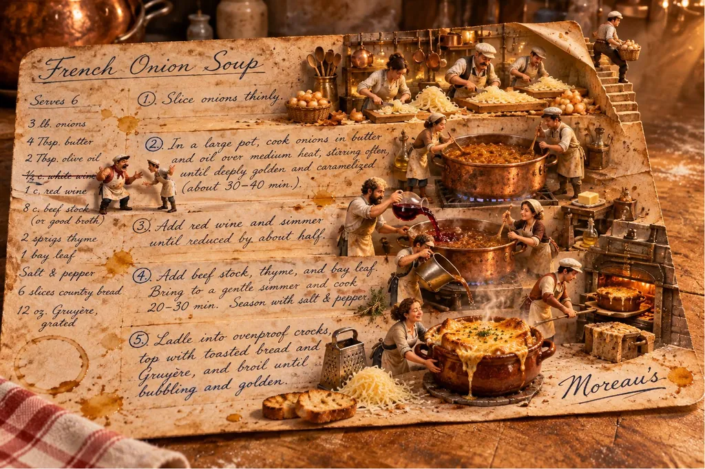

# Handwritten Recipe Card Unfolding into a Miniature Kitchen — by @AllaAisling

[← Back to Community Examples](../../EXAMPLES.md) · Category: Food & Drink · Model: `GPT Image 2.6`

<a href="https://x.com/AllaAisling/status/2126340017308242353"></a>

Source: **[@AllaAisling on X](https://x.com/AllaAisling/status/2126340017308242353)** · Creator: [Alexandra Aisling](https://x.com/AllaAisling)

## Prompt

```text
A grease-stained handwritten recipe card for [DISH], written in faded fountain-pen cursive, lying on a worn butcher-block counter. The recipe physically unfolds into a miniature kitchen rising from the card: each written step becomes a tiny diorama in reading order — [STEP 1 SCENE] at the top line, [STEP 2 SCENE] mid-card, the finished [DISH] steaming at the bottom where the ink signature "[FAMILY NAME]'s" sits. Tiny cooks in aprons work at card scale. Splatter stains become puddles, a crossed-out measurement has a miniature cook arguing beside it, the folded corner becomes a staircase. Warm tungsten kitchen light from the upper right, flour dust hanging in the beam, shallow depth of field, 100mm macro, nostalgic and edible.
```

## Try it

Paste the prompt into **[vinano.ai](https://vinano.ai?utm_source=github&utm_medium=readme&utm_campaign=awesome-image-video-prompts-updating&utm_content=x-page-try)** to generate your own version.

> The image and prompt belong to @AllaAisling ([original post](https://x.com/AllaAisling/status/2126340017308242353)) and are shown here with credit for reference. Creators can ask for changes or removal by opening an issue.
