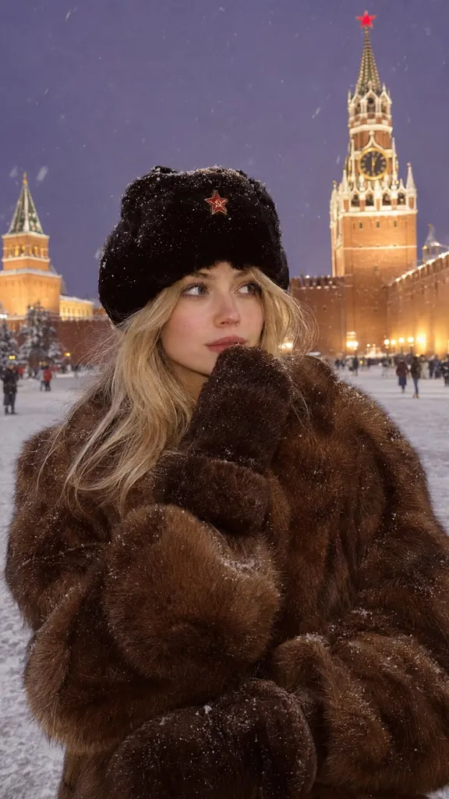

# Red Square Winter Fashion Portrait — by @Goodmanprotocol

[← Back to Community Examples](../../EXAMPLES.md) · Category: Photography · Model: `GPT Image 2.6`

<a href="https://x.com/Goodmanprotocol/status/2126303668983238817"></a>

Source: **[@Goodmanprotocol on X](https://x.com/Goodmanprotocol/status/2126303668983238817)** · Creator: [Saul Goodman](https://x.com/Goodmanprotocol)

## Prompt

```text
LUXURY RUSSIAN WINTER FASHION PORTRAIT | RED SQUARE, MOSCOW

Create an ultra-realistic winter fashion photograph of an elegant young adult woman standing in Red Square, Moscow, during a cold winter evening.

OUTFIT:
She wears an oversized, luxurious brown fur coat with rich, realistic fur texture and a large black Russian ushanka fur hat featuring a small traditional red star emblem. Her hands are covered in oversized matching brown fur mittens, with one mitten gently raised near her lips, creating a cozy, sophisticated winter pose.

APPEARANCE:
Blonde hair falling naturally around her face, delicate facial features, subtle natural makeup, softly flushed cheeks, and a calm, thoughtful expression. She gazes slightly to the side, away from the camera.

BACKGROUND:
The iconic Moscow Kremlin walls and Spasskaya Tower are clearly visible behind her, illuminated by warm golden architectural lighting. Deep lavender-blue winter twilight sky, subtle falling snowflakes, and a snow-covered Red Square.

PHOTOGRAPHY STYLE:
High-end editorial winter fashion photography, candid street-style aesthetic, realistic skin texture, intricate fur details, soft direct camera flash, balanced warm and cool lighting, shallow depth of field while keeping the Kremlin recognizable, cinematic color grading, authentic Russian winter atmosphere.

COMPOSITION:
Vertical 9:16 portrait, waist-up framing, subject positioned centrally in the foreground, natural pose, slightly off-camera gaze, professional DSLR photography, photorealistic, exceptional detail.

No artificial appearance, no watermark, no text.
```

## Try it

Paste the prompt into **[vinano.ai](https://vinano.ai?utm_source=github&utm_medium=readme&utm_campaign=awesome-image-video-prompts-updating&utm_content=x-page-try)** to generate your own version.

> The image and prompt belong to @Goodmanprotocol ([original post](https://x.com/Goodmanprotocol/status/2126303668983238817)) and are shown here with credit for reference. Creators can ask for changes or removal by opening an issue.
