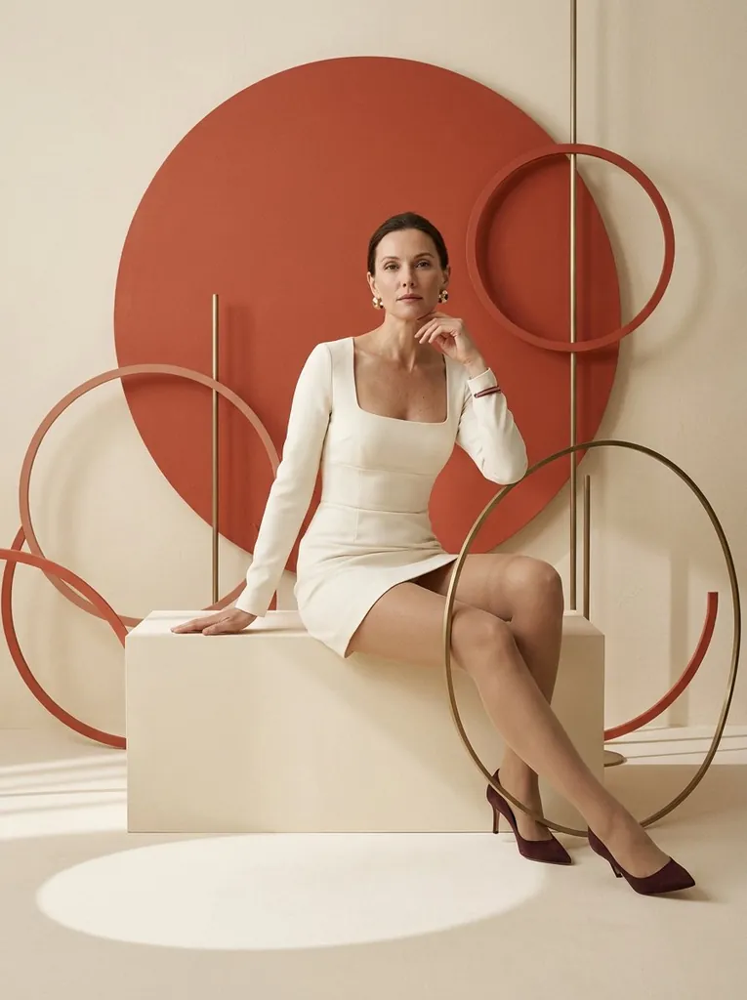

# Geometric Ivory Studio Fashion Editorial — by @dreamydigiarts

[← Back to Community Examples](../../EXAMPLES.md) · Category: Photography · Model: `Nano Banana 2`

<a href="https://x.com/dreamydigiarts/status/2126511409018130847"></a>

Source: **[@dreamydigiarts on X](https://x.com/dreamydigiarts/status/2126511409018130847)** · Creator: [dreamy digital arts](https://x.com/dreamydigiarts)

## Prompt

```text
Create a vertical 9:16 fashion editorial in a warm ivory studio built from oversized geometric forms. A large muted vermilion circular panel anchors the upper background while several smaller rings, partial arcs, and thin vertical metal rods occupy the space around an adult woman, creating a precise but irregular rhythm with generous negative space.

She wears a fitted ivory mini dress with a symmetrical square neckline, long sleeves, a sharply defined waist, and a clean high hem, paired with sheer neutral tights, dark burgundy heels, small sculptural gold earrings, and one slim cuff.

She sits sideways on a low rectangular plinth positioned partly in front of the large circle, one leg extended toward the camera and the other bent closer to the base. One hand rests flat on the plinth while the other lightly touches her jaw. Her torso stays relaxed and upright, chin level, eyes meeting the camera with a calm, unreadable expression.

Photograph from slightly below seated eye level with enough distance for the full geometry to remain legible. Let one thin ring overlap the edge of her silhouette and another fall behind her head without framing it perfectly. Use soft directional light that creates crisp circular shadows and fine linear shadows across the ivory floor and backdrop.

Keep the palette restrained: warm ivory, muted vermilion, dusty burgundy, brushed brass, and soft skin tones. Preserve matte fabric, painted surfaces, subtle paper-like wall texture, natural skin, precise shadows, and fine film grain. The final image should feel graphic, sensual, controlled, and unmistakably editorial rather than like a conventional studio portrait.
```

## Try it

Paste the prompt into **[vinano.ai](https://vinano.ai?utm_source=github&utm_medium=readme&utm_campaign=awesome-image-video-prompts-updating&utm_content=x-page-try)** to generate your own version.

> The image and prompt belong to @dreamydigiarts ([original post](https://x.com/dreamydigiarts/status/2126511409018130847)) and are shown here with credit for reference. Creators can ask for changes or removal by opening an issue.
