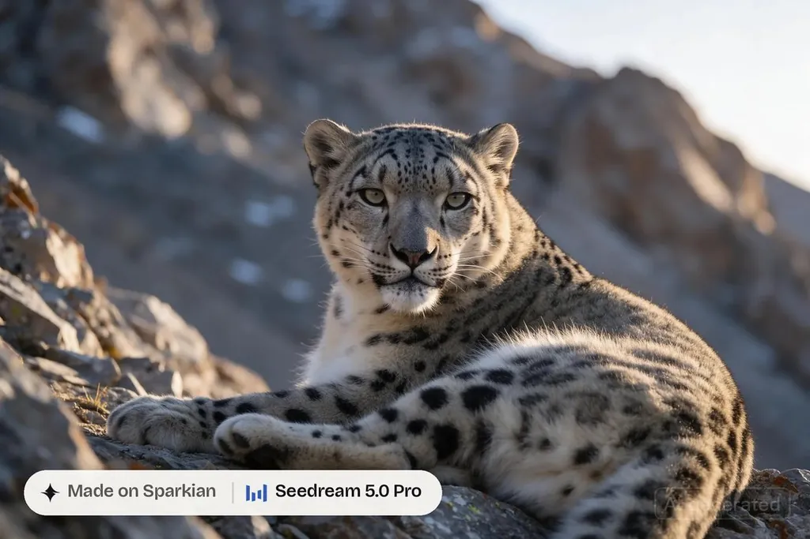

# Snow Leopard at Golden Hour — by @SparkianAI

[← Back to Community Examples](../../EXAMPLES.md) · Category: Photography · Model: `Seedream 5.0 Pro`

<a href="https://x.com/SparkianAI/status/2126360412425695505"></a>

Source: **[@SparkianAI on X](https://x.com/SparkianAI/status/2126360412425695505)** · Creator: [Sparkian](https://x.com/SparkianAI)

## Prompt

```text
A wildlife photograph of a snow leopard resting on a rocky ledge at golden hour. Sharp fur detail, soft background, telephoto look, no text.
```

## Try it

Paste the prompt into **[vinano.ai](https://vinano.ai?utm_source=github&utm_medium=readme&utm_campaign=awesome-image-video-prompts-updating&utm_content=x-page-try)** to generate your own version.

> The image and prompt belong to @SparkianAI ([original post](https://x.com/SparkianAI/status/2126360412425695505)) and are shown here with credit for reference. Creators can ask for changes or removal by opening an issue.
