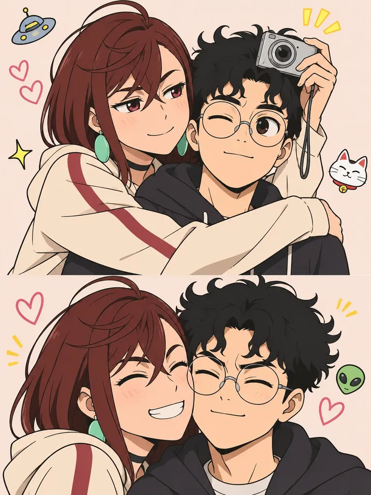

# Anime Couple Selfie Sheet — by @MoescapeAi

[← Back to Community Examples](../../EXAMPLES.md) · Category: Illustration & 3D · Model: `Seedream 5.0`

<a href="https://x.com/MoescapeAi/status/2126407957113917626"></a>

Source: **[@MoescapeAi on X](https://x.com/MoescapeAi/status/2126407957113917626)** · Creator: [Moescape AI](https://x.com/MoescapeAi)

## Prompt

```text
Create a cute anime illustration of two anime characters taking adorable couple selfies together. Show the characters standing or sitting close to each other, with one character holding a small digital camera up for a selfie while the other wraps their arms affectionately around them. Give them sweet, playful expressions, gentle smiles, blushing cheeks and natural interactions. Include different selfie poses such as cheek-to-cheek hugs, playful winks, laughing together and warm embraces. Add cute decorative elements like pink hearts, sparkles, bows and small character-themed doodles surrounding them.

Art style: High-quality anime illustration, clean and delicate line art, expressive facial features, beautifully detailed eyes, soft blush, smooth cel shading, warm pastel colors and polished anime aesthetics.

Use a vertical 3:4 composition featuring two stacked selfie panels, like a cute photo booth collage. Each panel should capture a different intimate moment between the characters, with close-up framing and natural smartphone camera angles. Keep both characters clearly visible with their iconic hairstyles, outfits and recognizable features.

Use a soft pastel background with minimal distractions, allowing the characters and their expressions to remain the focus. Add playful stickers, hearts and small decorative illustrations around the edges to create a scrapbook-inspired aesthetic.

Make the overall scene feel like a collection of candid couple selfies, capturing adorable everyday moments filled with affection, fun and personality.

Aspect ratio: Vertical 3:4.
```

## Try it

Paste the prompt into **[vinano.ai](https://vinano.ai?utm_source=github&utm_medium=readme&utm_campaign=awesome-image-video-prompts-updating&utm_content=x-page-try)** to generate your own version.

> The image and prompt belong to @MoescapeAi ([original post](https://x.com/MoescapeAi/status/2126407957113917626)) and are shown here with credit for reference. Creators can ask for changes or removal by opening an issue.
