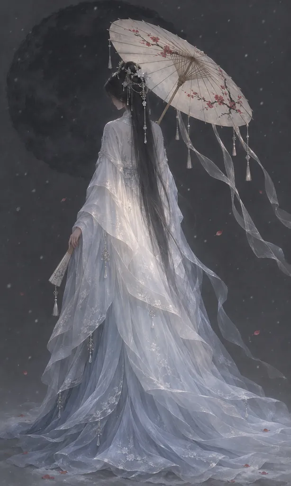

# Oil-Paper Umbrella Back View Under an Ink Moon — by @static_stare

[← Back to Community Examples](../../EXAMPLES.md) · Category: Illustration & 3D · Model: `GPT Image 2.5`

<a href="https://x.com/static_stare/status/2126286783608717535"></a>

Source: **[@static_stare on X](https://x.com/static_stare/status/2126286783608717535)** · Creator: [mo Ki](https://x.com/static_stare)

## Prompt

```text
Create an image with the following visual system. Replace the subject as specified.

Visual system (light, color, composition, medium, mood):
【画面风格】一张竖幅约 3:5 的古风人物插画，数字绘画，细腻柔和，衣料有半透明的层次和细微高光，不是动画赛璐珞，不是照片。底色是均匀的深炭灰，人物身后偏左有一个巨大的圆，像用墨晕开的满月，边缘毛糙，比底色再深一层。一位古装女子背对画面站立，身体微侧，头偏向左肩，只露出一点侧脸轮廓，看不清五官。她一手把油纸伞斜撑在右肩上，伞面是米白底上淡淡画着花，伞骨清楚，伞边垂下几条长长的半透明丝带和小流苏；另一只手垂在身侧，握着一把合起的折扇。乌黑长发直垂过腰，头上有精致的发饰和步摇。衣服是层层叠叠的宽袖曳地长裙，衣领完整，不露肩、不露背，衣边坠着银色小吊饰。衣服只用一种主色，从亮到暗过渡，中段被一束光照亮。小片飘落物从上往下稀疏地落。除了衣服是饱和色，其余都是灰和黑。画面里不要文字、印章、水印和签名。

New subject:
【主体】衣服是月白色，略带一点冷蓝；伞面画着几枝红梅；落下来的是细碎的雪片和几片红梅花瓣。
```

## Try it

Paste the prompt into **[vinano.ai](https://vinano.ai?utm_source=github&utm_medium=readme&utm_campaign=awesome-image-video-prompts-updating&utm_content=x-page-try)** to generate your own version.

> The image and prompt belong to @static_stare ([original post](https://x.com/static_stare/status/2126286783608717535)) and are shown here with credit for reference. Creators can ask for changes or removal by opening an issue.
