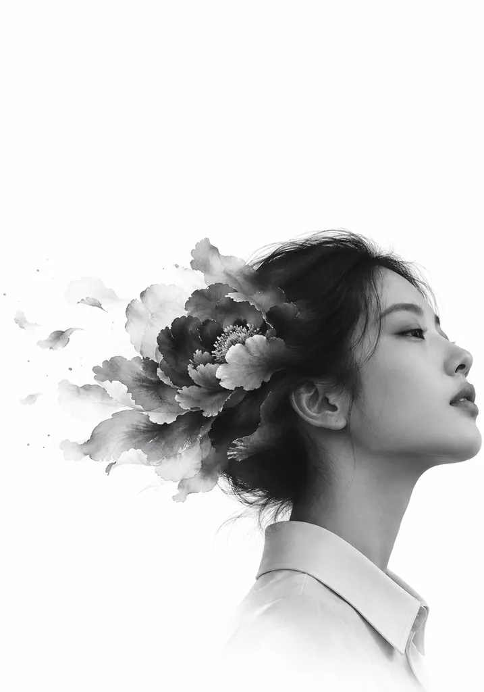

# Profile Portrait Dissolving into Ink Peonies — by @static_stare

[← Back to Community Examples](../../EXAMPLES.md) · Category: Illustration & 3D · Model: `GPT Image 2.5`

<a href="https://x.com/static_stare/status/2126316495194210399"></a>

Source: **[@static_stare on X](https://x.com/static_stare/status/2126316495194210399)** · Creator: [mo Ki](https://x.com/static_stare)

## Prompt

```text
Create an image with the following visual system. Replace the subject as specified.

Visual system (light, color, composition, medium, mood):
【画面风格】一张竖幅约 7:10 的黑白极简肖像，纯白背景，没有任何颜色。画面右侧是一位年轻东亚女性的侧脸，脸朝右，下巴微抬，眼睛平视或微闭，五官写实、皮肤细腻，用柔和的侧光打出鼻梁、嘴唇和下颌的轮廓，暗部是深灰。只到脖子和一点肩线，衣领完整。从耳朵往后，头发和后脑慢慢化开，向画面左侧散去，散开的部分是墨色的，有水墨晕染的浓淡和飞白，越往左越淡，最后消失在白底里，周围有少量细小的墨点。脸部清晰锐利，散开的部分柔软，两者过渡自然。构图留出左侧大片白，像高级杂志的艺术肖像页，安静、克制。不要彩色，不要文字、水印、签名，不要像任何明星。

New subject:
【主体】后脑散开成一片片墨色牡丹花瓣，花瓣从发间飘向左边，越飘越小、越淡。
```

## Try it

Paste the prompt into **[vinano.ai](https://vinano.ai?utm_source=github&utm_medium=readme&utm_campaign=awesome-image-video-prompts-updating&utm_content=x-page-try)** to generate your own version.

> The image and prompt belong to @static_stare ([original post](https://x.com/static_stare/status/2126316495194210399)) and are shown here with credit for reference. Creators can ask for changes or removal by opening an issue.
