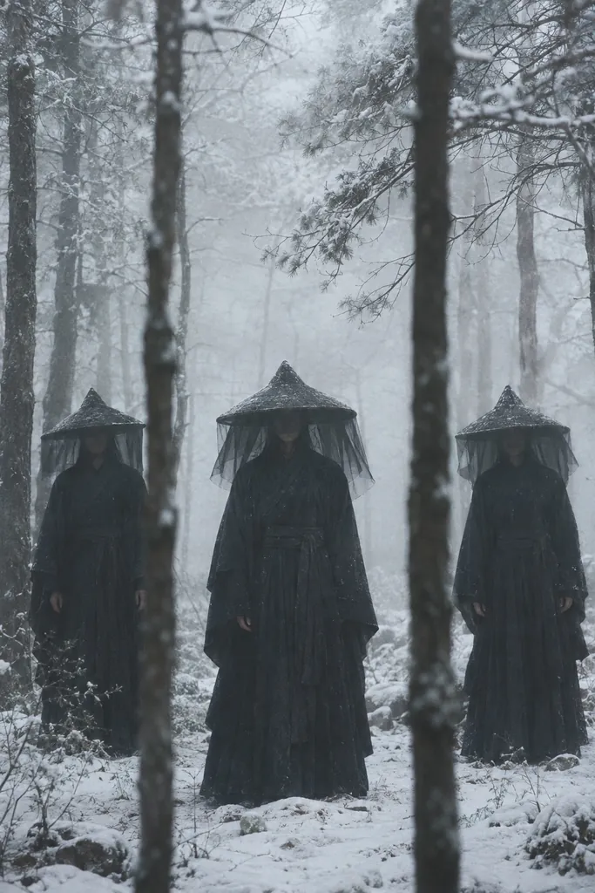

# Three Veiled Swordsmen in a Snowy Pine Forest — by @static_stare

[← Back to Community Examples](../../EXAMPLES.md) · Category: Photography · Model: `GPT Image 2.5`

<a href="https://x.com/static_stare/status/2126261782599868692"></a>

Source: **[@static_stare on X](https://x.com/static_stare/status/2126261782599868692)** · Creator: [mo Ki](https://x.com/static_stare)

## Prompt

```text
Create an image with the following visual system. Replace the subject as specified.

Visual system (light, color, composition, medium, mood):
【画面风格】一张竖幅约 2:3 的写实武侠电影剧照，像 35mm 胶片拍的，带细腻颗粒，色彩略低饱和、偏冷。平视中景，三个人站在画面中下部，中间一人稍前、两侧两人稍后，近乎对称，三人之间隔着前景的竖直树干。三人穿完全相同的长袍，戴宽檐尖顶斗笠，斗笠边缘垂下半透明的纱，遮住脸，只能隐约看到下巴轮廓；双手垂在身侧或拢在袖里。背景是被浓雾冲淡的树林，越往后越白，空气感很强；前景有一两根失焦的树干。光线是阴天的柔和漫射光，没有硬阴影。气氛安静、紧绷，像对峙前的一秒。没有拔出的刀剑，没有打斗，没有血。不是插画，不是 3D，不是 cosplay 影棚照。不要文字、字幕、水印和签名。

New subject:
【主体】场景是积雪的松树林，地上是雪。三人穿黑色长袍，斗笠垂黑纱，色调冷白灰。
```

## Try it

Paste the prompt into **[vinano.ai](https://vinano.ai?utm_source=github&utm_medium=readme&utm_campaign=awesome-image-video-prompts-updating&utm_content=x-page-try)** to generate your own version.

> The image and prompt belong to @static_stare ([original post](https://x.com/static_stare/status/2126261782599868692)) and are shown here with credit for reference. Creators can ask for changes or removal by opening an issue.
