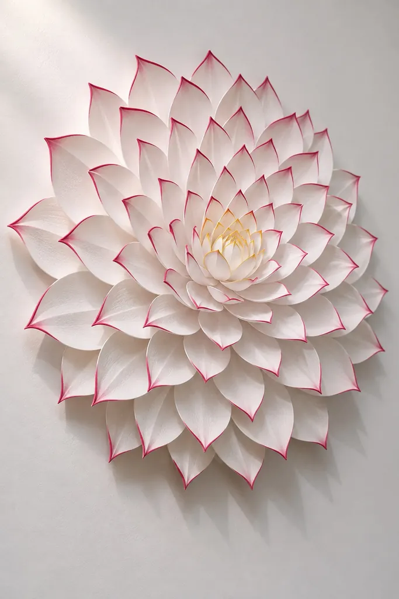

# White Paper Relief Lotus — by @static_stare

[← Back to Community Examples](../../EXAMPLES.md) · Category: Illustration & 3D · Model: `GPT Image 2.5`

<a href="https://x.com/static_stare/status/2126249100412920269"></a>

Source: **[@static_stare on X](https://x.com/static_stare/status/2126249100412920269)** · Creator: [mo Ki](https://x.com/static_stare)

## Prompt

```text
Create an image with the following visual system. Replace the subject as specified.

Visual system (light, color, composition, medium, mood):
【画面风格】一张竖幅约 2:3 的纸艺浮雕实拍照片。一件用白色卡纸做的立体浮雕挂在浅灰白墙上，镜头从左前方略斜着拍，能看出纸片的厚度和层次。浮雕由几百片同样大小的白纸片折成，一片压一片，从中心向外层层排开，越往外越大，有很强的旋转或放射节奏。纸片的正面都是白色，只有边缘或尖端涂了一窄条纯色，颜色在边缘形成一圈圈彩色的线。光从画面左上方打过来，是柔和但方向明确的侧光，每片纸都在下一片上投出细长的灰色影子，整件作品立体感很强。墙面干净，大面积留白，没有其他物品。安静、手工、有设计感。不是插画，不是 3D 渲染，不是平面图案。不要文字、水印、签名和 logo。

New subject:
【主体】白纸片折成一朵层层盛开的荷花，花瓣从中心往外展开，只有花瓣尖端涂一窄条胭脂红，最中心几片是嫩黄色边。
```

## Try it

Paste the prompt into **[vinano.ai](https://vinano.ai?utm_source=github&utm_medium=readme&utm_campaign=awesome-image-video-prompts-updating&utm_content=x-page-try)** to generate your own version.

> The image and prompt belong to @static_stare ([original post](https://x.com/static_stare/status/2126249100412920269)) and are shown here with credit for reference. Creators can ask for changes or removal by opening an issue.
