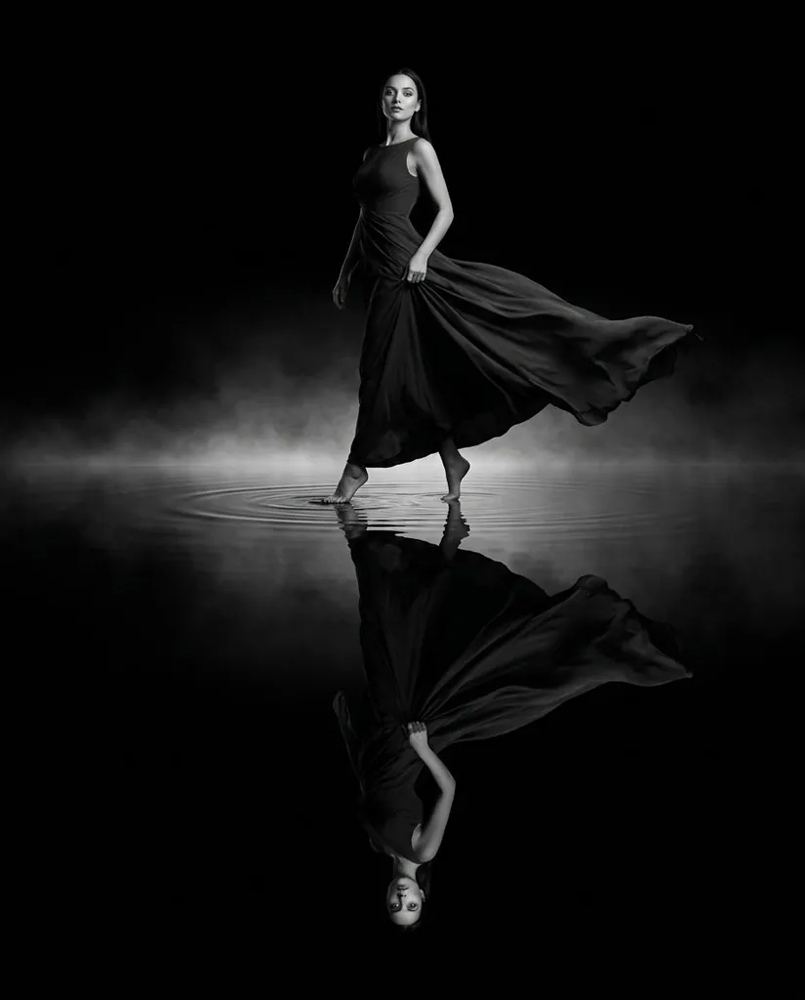

# Mirror-Lake Black-and-White Fashion Portrait — by @Just_Anika_Here

[← Back to Community Examples](../../EXAMPLES.md) · Category: Photography · Model: `GPT Image 2.5`

<a href="https://x.com/Just_Anika_Here/status/2126503847342256592"></a>

Source: **[@Just_Anika_Here on X](https://x.com/Just_Anika_Here/status/2126503847342256592)** · Creator: [Anika](https://x.com/Just_Anika_Here)

## Prompt

```text
Aspect Ratio: 4:5

An award-winning ultra-cinematic black-and-white fine art fashion portrait with perfect mirror symmetry.

The camera is positioned only a few centimetres above the surface of an endless mirror-like black lake using an ultra-low water-level perspective. The composition is perfectly centred, creating an almost identical upper and lower half.

A beautiful woman stands on the surface of an endless black mirror lake captured in a powerful modern high-fashion movement pose. She appears as if she has just taken a slow, elegant step forward — one leg slightly ahead with the heel subtly lifted above the water, creating a feeling of motion and confidence.

Her body has a graceful natural twist at the waist, creating a sculptural feminine silhouette. One hand gently gathers the flowing fabric of her couture gown while the other arm hangs naturally with effortless elegance. Her shoulders are relaxed, chin slightly raised, and her face turns toward the camera with a calm, mysterious expression.

The pose feels like a luxury fashion campaign captured at the exact moment between movement and stillness — confident, modern, sensual and unforgettable. Not a traditional dance pose, but an effortless editorial fashion moment.

Her dramatic couture gown flows sideways as if moved by an invisible wind, creating beautiful waves of fabric that extend into the darkness. The flowing fabric creates a powerful connection between the real woman and her reflection below.

The water is flawlessly smooth like polished obsidian glass, producing a razor-sharp, full-length reflection that occupies nearly the entire lower half of the frame.

The reflection is the visual hero of the image. The woman's silhouette, forward step, flowing gown, elegant posture and subtle body movement are perfectly mirrored without distortion, creating an impossible symmetrical illusion. The reflection appears slightly more dramatic and expressive than reality, as if the water contains a more powerful version of her.

Tiny concentric ripples gently spread outward from her touching foot while preserving the crystal-clear reflection.

The environment is swallowed in absolute velvet-black darkness. There are no walls, no background, no landscape — only infinite darkness and endless mirror water.

The ONLY light source comes from the glossy black water itself. Soft silver reflections rise naturally from the surface, delicately illuminating only her eyes, eyelashes, the bridge of her nose and subtle cheekbone contours. Everything else — hair, lips, forehead, jawline, neck and clothing — melts into deep black shadow.

A thin layer of cinematic mist floats just above the water, catching only the faintest silver highlights without hiding the reflection. The atmosphere feels dreamlike, surreal and timeless.

Extreme chiaroscuro, perfect bilateral symmetry, negative space, museum-quality fine art photography, luxury fashion editorial, Vogue Italia aesthetic, Hasselblad X2D medium-format camera, 80mm lens, ultra-high dynamic range, Kodak Tri-X monochrome film, deep analogue blacks, luminous silver highlights, impossible realism, award-winning composition, visually unforgettable.

Negative Prompt:

traditional ballet pose, stiff standing pose, static posture, awkward hands, unnatural body position, ocean, waves, shoreline, visible background, extra light sources, cropped reflection, broken reflection, distorted reflection, duplicate subject, colour, text, logo, watermark, CGI, low quality, blurry reflection, bad anatomy, asymmetrical composition.

The reflected woman has slightly wider, brighter eyes and a more intense expression, looking directly at the viewer, while the real woman remains calm, elegant and mysterious — creating a surreal contrast between reality and reflection.
```

## Try it

Paste the prompt into **[vinano.ai](https://vinano.ai?utm_source=github&utm_medium=readme&utm_campaign=awesome-image-video-prompts-updating&utm_content=x-page-try)** to generate your own version.

> The image and prompt belong to @Just_Anika_Here ([original post](https://x.com/Just_Anika_Here/status/2126503847342256592)) and are shown here with credit for reference. Creators can ask for changes or removal by opening an issue.
