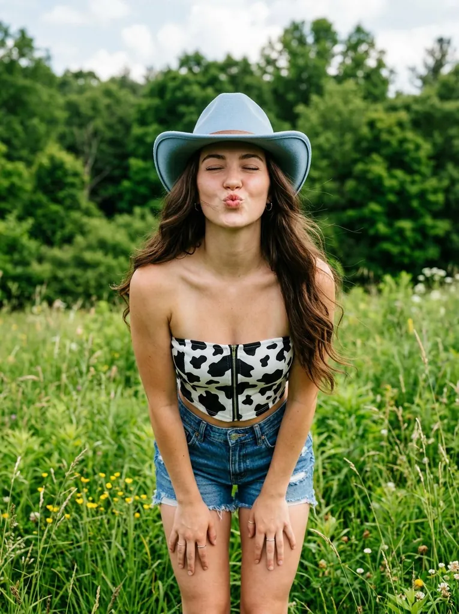

# Cowboy Hat in a Green Field — by @dreamydigiarts

[← Back to Community Examples](../../EXAMPLES.md) · Category: Photography · Model: `Nano Banana 2`

<a href="https://x.com/dreamydigiarts/status/2126307560567259542"></a>

Source: **[@dreamydigiarts on X](https://x.com/dreamydigiarts/status/2126307560567259542)** · Creator: [dreamy digital arts](https://x.com/dreamydigiarts)

## Prompt

```text
A young woman with long brown hair stands in a lush green field wearing a light blue cowboy hat and making a playful kissing face with her eyes closed.

Subject: A young woman with long dark brown hair and fair skin, posing playfully with her lips puckered and eyes closed.

Clothing: She wears a white and black cow-print strapless tube top with a visible zipper down the front, paired with blue denim shorts that have a frayed hem.

Action: The subject is leaning forward slightly with her hands resting near her thighs, tilting her head back while making a kissing gesture.

Environment: A vibrant green meadow filled with tall grass and wildflowers, backed by a dense line of dark green trees in the distance.

Lighting: Natural daylight illuminates the scene evenly, creating soft shadows and highlighting the texture of the grass and the subject's skin.

Camera: Medium shot capturing the upper body from the waist up, framed vertically with a shallow depth of field that keeps the subject sharp while softly blurring the background foliage.

Style Details: High-resolution photography with vibrant natural colors and a focus on outdoor fashion aesthetics.
```

## Try it

Paste the prompt into **[vinano.ai](https://vinano.ai?utm_source=github&utm_medium=readme&utm_campaign=awesome-image-video-prompts-updating&utm_content=x-page-try)** to generate your own version.

> The image and prompt belong to @dreamydigiarts ([original post](https://x.com/dreamydigiarts/status/2126307560567259542)) and are shown here with credit for reference. Creators can ask for changes or removal by opening an issue.
