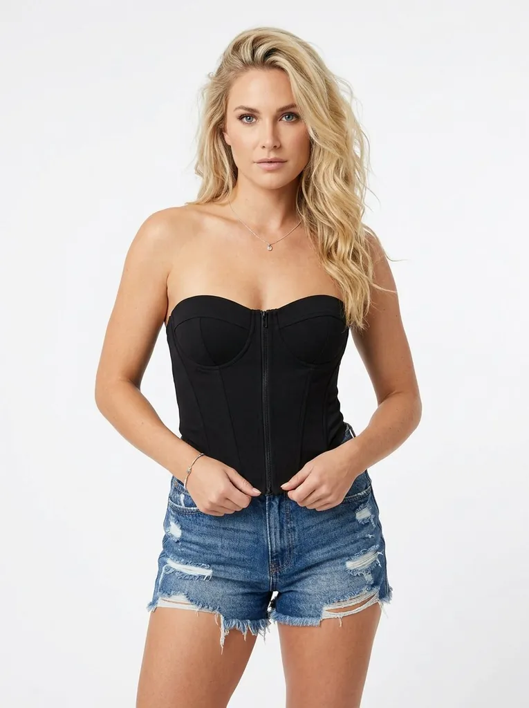

# Blonde Studio Portrait on White — by @dreamydigiarts

[← Back to Community Examples](../../EXAMPLES.md) · Category: Photography · Model: `Nano Banana 2`

<a href="https://x.com/dreamydigiarts/status/2126337758088024421"></a>

Source: **[@dreamydigiarts on X](https://x.com/dreamydigiarts/status/2126337758088024421)** · Creator: [dreamy digital arts](https://x.com/dreamydigiarts)

## Prompt

```text
A confident woman with long blonde hair stands against a plain white background.

Subject: A fair-skinned woman with voluminous, wavy blonde hair that falls over her shoulders and partially covers her face. She has blue eyes and is looking directly at the camera with a neutral, slightly serious expression.

Clothing: She wears a black strapless corset top featuring a long zipper running down the center of the bodice. Her outfit includes distressed denim shorts with frayed hems and visible white lining inside the waistband. A delicate silver necklace with a small pendant rests on her chest, and she wears a thin bracelet on her left wrist.

Action: She stands facing forward in a relaxed pose, holding the waistband of her shorts with both hands as if pulling them down slightly. Her arms are bent at the elbows, and her posture is upright but casual.

Environment: The background is a seamless, solid white studio backdrop that provides no spatial context or environmental details.

Camera: A medium shot captures the subject from the thighs up, framed vertically to emphasize her full figure against the clean background.

Lighting: Bright, even studio lighting illuminates the scene from the front, creating soft shadows behind her and highlighting the texture of her hair and clothing without harsh contrasts.

Style Details: The image has a polished commercial photography aesthetic with high clarity and sharp focus on the subject.
```

## Try it

Paste the prompt into **[vinano.ai](https://vinano.ai?utm_source=github&utm_medium=readme&utm_campaign=awesome-image-video-prompts-updating&utm_content=x-page-try)** to generate your own version.

> The image and prompt belong to @dreamydigiarts ([original post](https://x.com/dreamydigiarts/status/2126337758088024421)) and are shown here with credit for reference. Creators can ask for changes or removal by opening an issue.
