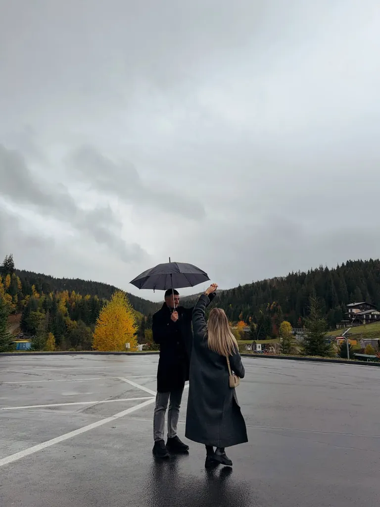

# Hand-Painted Storybook Animation Scene Template — by @Sairah_0

[← Back to Community Examples](../../EXAMPLES.md) · Category: Illustration & 3D · Model: `GPT Image 2`

<a href="https://x.com/Sairah_0/status/2125831976070611123"></a>

Source: **[@Sairah_0 on X](https://x.com/Sairah_0/status/2125831976070611123)** · Creator: [Sairah](https://x.com/Sairah_0)

## Prompt

```text
Create a beautifully detailed, cinematic 2D animated illustration in a classic hand-painted Disney-inspired storybook aesthetic. Depict [YOUR SUBJECT / CHARACTERS] in [YOUR LOCATION / SETTING], capturing a romantic, dreamy, nostalgic atmosphere.

Use elegant character designs, expressive faces, natural poses, beautifully flowing hair, detailed clothing, and refined hand-drawn outlines. Surround the characters with a breathtaking environment featuring [ENVIRONMENT DETAILS], atmospheric depth, and intricate background elements.

Use a rich autumn-inspired color palette with warm golden amber, muted orange, deep forest green, earthy brown, and soft charcoal tones. Incorporate cinematic lighting, soft atmospheric haze, subtle film grain, painterly textures, and beautiful reflections where appropriate.

The composition should feel like a frame from a high-budget animated romantic movie, with a magical fairytale atmosphere, breathtaking scenery, emotional storytelling, and sophisticated visual composition.

Highly detailed traditional 2D animation, hand-painted backgrounds, timeless storybook aesthetics, cinematic framing, professional animation artwork, beautiful color grading, 4K quality. Avoid photorealism, 3D CGI, plastic textures, and overly exaggerated cartoon features.
```

## Try it

Paste the prompt into **[vinano.ai](https://vinano.ai?utm_source=github&utm_medium=readme&utm_campaign=awesome-image-video-prompts-updating&utm_content=x-page-try)** to generate your own version.

> The image and prompt belong to @Sairah_0 ([original post](https://x.com/Sairah_0/status/2125831976070611123)) and are shown here with credit for reference. Creators can ask for changes or removal by opening an issue.
