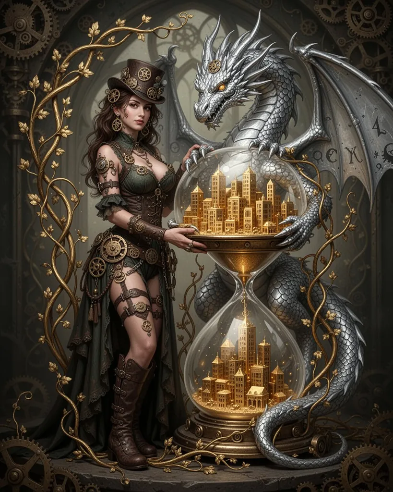

# Steampunk Hourglass with a Golden Miniature City — by @ukrroot

[← Back to Community Examples](../../EXAMPLES.md) · Category: Illustration & 3D · Model: `Flux 2`

<a href="https://x.com/ukrroot/status/2125773186482549203"></a>

Source: **[@ukrroot on X](https://x.com/ukrroot/status/2125773186482549203)** · Creator: [Rompel](https://x.com/ukrroot)

## Prompt

```text
Steampunk woman with silver dragon beside glass hourglass holding a golden miniature city, golden vines
```

## Try it

Paste the prompt into **[vinano.ai](https://vinano.ai?utm_source=github&utm_medium=readme&utm_campaign=awesome-image-video-prompts-updating&utm_content=x-page-try)** to generate your own version.

> The image and prompt belong to @ukrroot ([original post](https://x.com/ukrroot/status/2125773186482549203)) and are shown here with credit for reference. Creators can ask for changes or removal by opening an issue.
