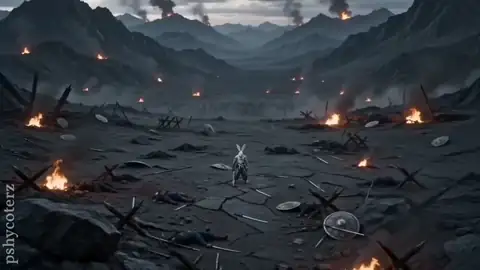

# Rabbit Samurai on a Fallen Battlefield — by @draavenai

[← Back to Community Examples](../../EXAMPLES.md) · Category: Video · Model: `Seedance 2.0`

<a href="https://x.com/draavenai/status/2126313066413642091"></a>

**[▶ Watch the full video on X](https://x.com/draavenai/status/2126313066413642091)** — the preview above is a short silent clip.

Source: **[@draavenai on X](https://x.com/draavenai/status/2126313066413642091)** · Creator: [Draaven](https://x.com/draavenai)

## Prompt

```text
A cinematic dark fantasy scene featuring a small anthropomorphic white rabbit warrior standing alone in the middle of a devastated battlefield. The rabbit wears traditional samurai-inspired armor, a dark blue warrior outfit, and carries a katana sword. Broken shields, abandoned weapons, burning debris, and thick smoke cover the battlefield. Dark mountains stretch across the horizon beneath a dramatic stormy sky. The tiny warrior stands fearlessly, holding his sword with determination despite the enormous battlefield surrounding him. The camera slowly moves closer, revealing his detailed armor, expressive eyes, and the sword reflecting the firelight. Cinematic wide shots, dramatic atmosphere, realistic smoke and fire, detailed 3D character animation, dark fantasy movie aesthetic, ultra-realistic CGI, 4K quality.
```

## Try it

Paste the prompt into **[vinano.ai](https://vinano.ai?utm_source=github&utm_medium=readme&utm_campaign=awesome-image-video-prompts-updating&utm_content=x-page-try)** to generate your own version.

> The video and prompt belong to @draavenai ([original post](https://x.com/draavenai/status/2126313066413642091)) and are shown here with credit for reference. Creators can ask for changes or removal by opening an issue.
