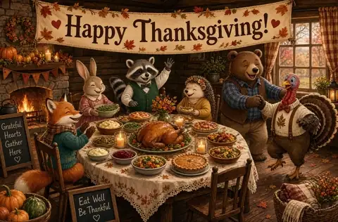

# Thanksgiving Feast with Dressed-Up Animals — by @mikeyNYCfit

[← Back to Community Examples](../../EXAMPLES.md) · Category: Video · Model: `Grok Imagine`

<a href="https://x.com/mikeyNYCfit/status/2125969618477199605"></a>

**[▶ Watch the full video on X](https://x.com/mikeyNYCfit/status/2125969618477199605)** — the preview above is a short silent clip.

Source: **[@mikeyNYCfit on X](https://x.com/mikeyNYCfit/status/2125969618477199605)** · Creator: [Michael Tow](https://x.com/mikeyNYCfit)

## Prompt

```text
Happy Thanksgiving scene with cute animals dressed in human clothing celebrating and eating and dancing with a banner on the top of the scene, the animals say “happy Thanksgiving to all, thanks for all we have to eat and enjoy”
```

## Try it

Paste the prompt into **[vinano.ai](https://vinano.ai?utm_source=github&utm_medium=readme&utm_campaign=awesome-image-video-prompts-updating&utm_content=x-page-try)** to generate your own version.

> The video and prompt belong to @mikeyNYCfit ([original post](https://x.com/mikeyNYCfit/status/2125969618477199605)) and are shown here with credit for reference. Creators can ask for changes or removal by opening an issue.
