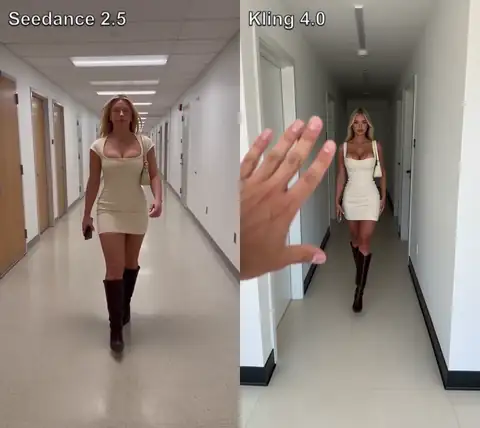

# One-Take Hallway Freeze and Finger Snap — by @Sleaper_

[← Back to Community Examples](../../EXAMPLES.md) · Category: Video · Model: `Seedance 2.5`

<a href="https://x.com/Sleaper_/status/2125878016576286795"></a>

**[▶ Watch the full video on X](https://x.com/Sleaper_/status/2125878016576286795)** — the preview above is a short silent clip.

Source: **[@Sleaper_ on X](https://x.com/Sleaper_/status/2125878016576286795)** · Creator: [Sleeper](https://x.com/Sleaper_)

## Prompt

```text
Create a **15-second video filmed in one continuous handheld shot**. A tall blonde woman walks through a bright hallway, freezes at the camera operator’s hand gesture, and resumes walking after a finger snap.

**THE WOMAN**

A beautiful **20-year-old adult woman, approximately 190 cm tall**, with long blonde hair, blue eyes, long legs, and realistic body proportions.

She has a noticeably full, voluptuous bust, a defined waist, and rounded, slightly fuller hips and buttocks. Her height should be clearly apparent beside the hallway’s standard doorframes. Preserve her stature and proportions from every angle.

She wears a fitted cream mini dress with a square neckline and a shaped bodice that accommodates her full bust. The dress follows her waist and hips, with natural fabric tension and folds. Dark brown knee-high heeled boots complete the outfit.

A small cream handbag remains on her left shoulder. A smartphone stays in her right hand.

**LOCATION**

A bright hallway with white walls, pale flooring, dark baseboards, regularly spaced doors, and long ceiling lights. Natural indoor lighting and consistent shadows beneath her feet.

**0–2 seconds — Approach and freeze.**

Open with a full-body frontal view as she walks toward the camera. Keep her entire figure visible, including her head and boots.

The operator raises a left hand near the lens, fingers spread, palm toward her. She immediately freezes with one foot slightly ahead, her phone at her right side.

The operator lowers the hand.

**2–11.5 seconds — Smooth movement around her to the rear.**

The camera moves in one slow, uninterrupted semicircle around her right side, progressing from the frontal view through her right profile and finally settling directly behind her.

She remains completely still. Her feet stay planted in the same positions, and her head, gaze, arms, hair, and accessories remain fixed. She does not rotate to follow the camera.

Maintain enough distance to show her tall figure and natural proportions. The movement should feel like someone carefully walking around her with a camera, with gentle handheld sway.

By 11.5 seconds, the camera is approximately two to three meters behind her, facing the same direction she will walk. Frame her full body.

**11.5–12 seconds — Snap from behind.**

While the camera remains in this rear position, the operator’s left hand briefly enters the lower corner of the frame and performs one finger snap. The hand never covers the lens.

Synchronize the sound with the gesture. She immediately begins moving again.

**12–15 seconds — Seamless walking continuation.**

From the exact same rear viewpoint, show her shift her weight and naturally complete her first step.

The camera smoothly accelerates into a following walk, maintaining approximately the same distance behind her. Preserve the same framing, camera height, lighting, and hallway perspective through the transition.

Her blonde hair begins swaying, her handbag moves gently against her left side, and the dress shifts naturally with her stride. Her phone remains in her right hand.

Follow her for the entire final three seconds and end while she is still walking.

**CONTINUITY AND SOUND**

The whole video is one uninterrupted take. No cuts, viewpoint jumps, sudden pans, camera resets, or abrupt changes in distance. The transition from standing still to walking happens visibly within the same shot.

Quiet hallway ambience, natural heel clicks, and one clear finger snap. No dialogue, captions, logos, or magical visual effects.
```

## Try it

Paste the prompt into **[vinano.ai](https://vinano.ai?utm_source=github&utm_medium=readme&utm_campaign=awesome-image-video-prompts-updating&utm_content=x-page-try)** to generate your own version.

> The video and prompt belong to @Sleaper_ ([original post](https://x.com/Sleaper_/status/2125878016576286795)) and are shown here with credit for reference. Creators can ask for changes or removal by opening an issue.
