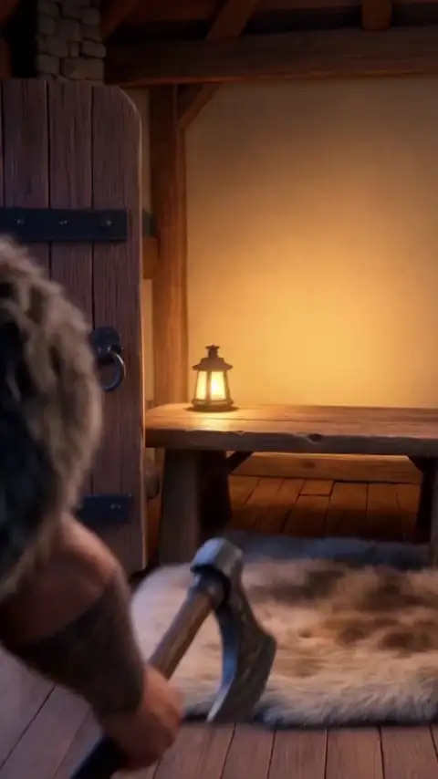

# Animated Short: The Most Terrifying Opponent — by @SerJArt7trp

[← Back to Community Examples](../../EXAMPLES.md) · Category: Video · Model: `Kling 4.0`

<a href="https://x.com/SerJArt7trp/status/2125965358297239611"></a>

**[▶ Watch the full video on X](https://x.com/SerJArt7trp/status/2125965358297239611)** — the preview above is a short silent clip.

Source: **[@SerJArt7trp on X](https://x.com/SerJArt7trp/status/2125965358297239611)** · Creator: [RolfAI](https://x.com/SerJArt7trp)

## Prompt

```text
Create a short animated film titled “The Most Terrifying Opponent” in the style of Pixar.

FORMAT AND VISUAL STYLE

30 seconds, vertical 9:16 format, 24 frames per second. High-quality 3D animation with expressive faces, slightly exaggerated proportions, lively character movement, and detailed hair, fur, leather, and wood. Cinematic lighting and soft shadows.

Tell the story through actions and facial expressions. No dialogue, voiceover, on-screen text, or subtitles.

Emotional progression: suspicion → recognition → pretend battle → warmth and humor.

CHARACTERS

The Viking: Preserve the recognizable features of our character from the reference, adapting his appearance into Pixar-style animation. A large, broad-shouldered man with powerful arms, blue eyes, a thick sandy-brown beard, shaved sides, and a long side braid. Tattoos cover his arms and upper chest. He wears weathered dark-brown leather armor with straps, a fur mantle, dark trousers, and heavy boots. A little snow remains on his fur. When entering, he carries a battle axe and a round wooden shield. His stern face can instantly become warm and comically expressive.

The son: A three-year-old boy with round cheeks, large blue eyes, and tousled light-blond hair. He wears a cozy green dragon costume with a cream-colored belly. The hood has soft horns, small wings sit on his back, and a short tail hangs behind him. He holds one soft toy sword. He tries very hard to look frightening, but the result is adorable.

LOCATION AND LIGHTING

A cozy wooden Viking house on a winter evening. Heavy timber beams, a rough wooden table, a bench, a stone hearth, and a thick fur rug on the floor. Snow and cold blue twilight are visible through the open doorway. The interior glows with warm golden light.

The boy is hiding behind the table. A low-positioned warm lantern illuminates him from behind: the child stands between the lantern and the far wall. His horned hood and little wings cast an enormous dragon-shaped shadow onto the wall. The boy himself is initially hidden from anyone standing at the entrance.

STORY AND CAMERA MOVEMENT

0–7 seconds — A monster in the house.
The heavy wooden door creaks open. The camera follows the Viking into the house from behind his shoulder. He takes two heavy steps and freezes: an enormous horned shadow moves across the far wall.
An earnest, quiet growl comes from behind the table. The Viking narrows his eyes, tightens his grip on the handle of his lowered axe, and slowly raises his shield. The camera moves closer to his suspicious face, keeping the shadow visible in the background.

7–12 seconds — The reveal.
The camera smoothly moves sideways, revealing the space behind the table. His little son is standing there in a dragon costume, stretching out his arms, puffing up his cheeks, and trying to growl menacingly. The enormous shadow mirrors his every movement.

The Viking recognizes his son. His tension disappears, his eyebrows rise, and a warm smile begins to form at the corners of his mouth. The boy notices his father and happily raises his toy sword.
12–15 seconds — Challenge accepted.
The Viking hangs his real axe and shield on their wall mounts beside the entrance. His hands are now empty. He turns toward his son, deliberately straightens up, and assumes an exaggeratedly serious fighting stance.

The boy steps out from behind the table, snorting with determination. His soft costume tail drags comically across the floor.

15–23 seconds — A glorious victory.
The son runs up to his father and lightly taps the leather armor over his belly with the toy sword.
The Viking freezes for a brief moment. Then his eyes open wide, he clutches his chest, and takes two theatrical steps backward as though struck by an unbelievably powerful blow. His beard and fur bounce comically.

He slowly lowers himself onto the thick fur rug with exaggerated drama, spreads his arms, and closes his eyes. The child remains standing safely beside him, outside the area where he falls. The entire interaction clearly feels like a playful game between father and son.

23–30 seconds — The victor checks his opponent.
The boy proudly raises his toy sword above his head and laughs. The camera gently moves closer, keeping both the happy child and his father’s face in the frame.
The Viking carefully opens one eye, looks at his son, and allows himself the slightest smile. When the boy leans down to check on his defeated opponent, the father immediately squeezes his eye shut and pretends to be completely motionless again.

Hold the final moment for two seconds: the son smiles with satisfaction while the corner of the Viking’s mouth gives him away.

CAMERA

One continuous, smooth tracking shot: enter behind the Viking → move sideways to reveal the child → pull back slightly for the pretend battle → move closer for the final reaction. Maintain a clear and consistent spatial relationship between the doorway, table, lantern, and fur rug.
SOUND AND MUSIC

At the beginning: quiet winter wind, the creaking door, heavy footsteps, rustling fur, and a faint clink of equipment. Subtle, suspenseful orchestral music emphasizes the enormous shadow.

When the child is revealed, the music becomes playful, with pizzicato strings and light woodwinds. Keep the boy’s growling, quick footsteps, the soft tap of the toy sword, the father’s exaggerated groan, his muffled landing on the fur, and the child’s laughter clearly audible.

End with a warm musical phrase that continues through the final frame. The music supports the action while allowing the sound effects to remain clear.

CONTINUITY

Only the father and son appear in the scene. The enormous dragon exists solely as the child’s shadow and always mirrors his movements. Keep the characters’ appearance, clothing, and proportions consistent throughout. Once the Viking hangs his axe and shield beside the entrance, they remain there until the end. The boy keeps the same toy sword throughout the scene.
```

## Try it

Paste the prompt into **[vinano.ai](https://vinano.ai?utm_source=github&utm_medium=readme&utm_campaign=awesome-image-video-prompts-updating&utm_content=x-page-try)** to generate your own version.

> The video and prompt belong to @SerJArt7trp ([original post](https://x.com/SerJArt7trp/status/2125965358297239611)) and are shown here with credit for reference. Creators can ask for changes or removal by opening an issue.
