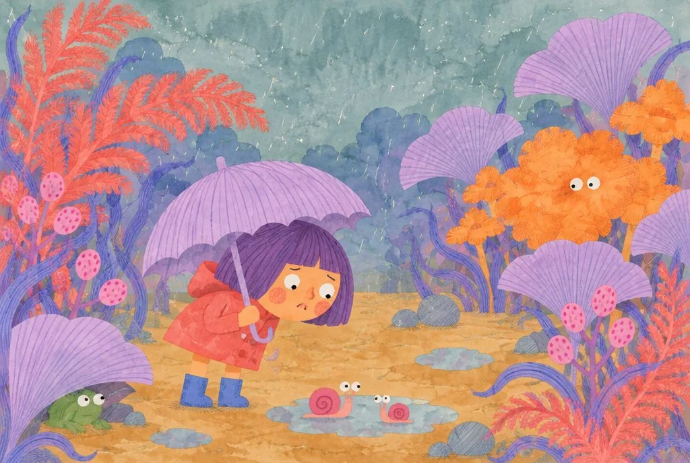

# Watercolor and Colored Pencil Picture-Book Template — by @JackieLiu_13

[← Back to Community Examples](../../EXAMPLES.md) · Category: Illustration & 3D · Model: `GPT Image`

<a href="https://x.com/JackieLiu_13/status/2120182176390037876"></a>

Source: **[@JackieLiu_13 on X](https://x.com/JackieLiu_13/status/2120182176390037876)** · Creator: [大龙](https://x.com/JackieLiu_13)

## Prompt

```text
手绘儿童绘本插画，传统媒介质感。底层是水彩与水粉的大色块，色块内部能看到水色深浅不匀、笔刷方向和颜料颗粒沉淀，边缘有水渍，色块之间半透明地互相叠压。上层用彩色铅笔画线和排线，线条颜色与填色是同色系（不是墨线、不是深色描边），粗细不匀、略带手抖，很多形状干脆不勾边，纹理用手画的平行铅笔线表现。画面平面、装饰性强，没有线性透视，纵深只靠色块层层遮挡和远处变冷变暗。没有统一光源、没有体积阴影，物体下方只有彩铅排线画的小块接触阴影。背景撒有细小的白色和浅色颗粒点。深色用靛蓝或深紫，不用纯黑。

场景：【场景】。构图：【构图】，分布有疏有密，物件大小悬殊，部分互相遮挡。
装饰纹样：【4–6 种纹样，每种配一个颜色】。
色彩：【色彩档位】。
角色：都很小，只占画面高度的六分之一左右，身体是没有细节的平涂剪影，没有鼻子、嘴巴和爪子细节；眼睛是白色圆形加一个黑色圆点瞳孔，略大、略歪。【谁、在哪、在做什么】。
【可选手法】

不要矢量扁平风，不要3D渲染，不要平滑数字渐变，不要光泽高光，不要写实光影，不要统一的纸纹滤镜，不要任何文字。
```

## Try it

Paste the prompt into **[vinano.ai](https://vinano.ai?utm_source=github&utm_medium=readme&utm_campaign=awesome-image-video-prompts-updating&utm_content=x-page-try)** to generate your own version.

> The image and prompt belong to @JackieLiu_13 ([original post](https://x.com/JackieLiu_13/status/2120182176390037876)) and are shown here with credit for reference. Creators can ask for changes or removal by opening an issue.
