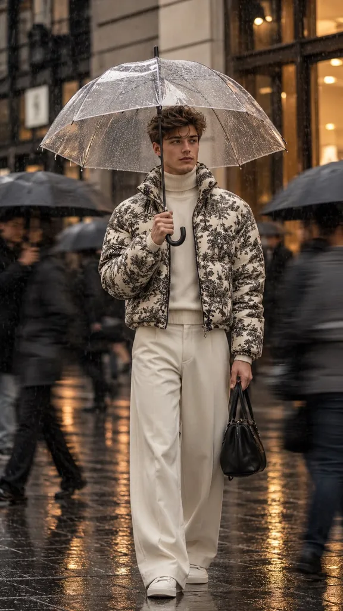

# Rainy Street-Style Menswear Portrait — by @OrhanGhazi65942

[← Back to Community Examples](../../EXAMPLES.md) · Category: Photography · Model: `GPT Image 2`

<a href="https://x.com/OrhanGhazi65942/status/2121593952059134027"></a>

Source: **[@OrhanGhazi65942 on X](https://x.com/OrhanGhazi65942/status/2121593952059134027)** · Creator: [ORHAN](https://x.com/OrhanGhazi65942)

## Prompt

```text
Create an ultra-photorealistic luxury street-style fashion photograph of a handsome young adult man in his mid-20s, with naturally styled dark hair, a well-defined masculine jawline, refined facial features, realistic skin texture, and a calm, confident expression.

Pose & Composition:

He stands naturally in the middle of a busy city street on a rainy day, holding a large transparent dome umbrella above his head with one hand. His body faces slightly toward the camera while his head is turned toward the right side of the frame, looking into the distance with a composed, thoughtful expression. His other hand casually carries a sleek black leather handbag. Capture his entire body in a vertical full-length fashion photograph, maintaining the same camera angle, subject placement, and perspective as the reference image.

Outfit & Styling:

He wears a sophisticated cream-colored high-neck knit sweater underneath a cropped cream-and-charcoal bomber jacket featuring intricate black botanical and vintage floral patterns. The jacket has a slightly oversized silhouette, padded texture, a raised collar, and subtle black detailing. Pair it with elegant, relaxed-fit ivory wide-leg tailored trousers with a flowing drape and clean construction. Complete the look with understated luxury footwear, mostly visible beneath the trousers.

Umbrella & Accessories:

A large transparent umbrella with a curved black handle and slim black metal ribs, featuring realistic raindrops and water droplets scattered across its clear surface. He holds the umbrella naturally at chest level. A minimalist black leather handbag hangs casually from his other hand.

Environment & Background:

A sophisticated European-style city shopping street during gentle rainfall. Elegant architectural facades, large glass storefront windows, warm amber interior lighting, wet pavement reflecting the surrounding lights, and several pedestrians carrying dark umbrellas in the background. Keep the surrounding people naturally blurred with subtle motion blur, creating a cinematic sense of movement while the male subject remains perfectly sharp.

Photography & Lighting:

Shot on a professional Canon EOS R5 with an 85mm portrait lens, shallow depth of field, natural overcast daylight mixed with warm storefront lighting, realistic reflections, beautifully controlled highlights, detailed fabric textures, authentic rain droplets, and cinematic color grading. Premium luxury fashion editorial photography, understated quiet-luxury aesthetic, sophisticated neutral color palette, exceptional photorealism.

Aspect Ratio: 9:16 vertical portrait.

Preserve the reference image’s overall composition, umbrella placement, full-body framing, outfit silhouette, rainy urban atmosphere, background pedestrian movement, and elegant editorial mood. No text, no logos, no watermark.
```

## Try it

Paste the prompt into **[vinano.ai](https://vinano.ai?utm_source=github&utm_medium=readme&utm_campaign=awesome-image-video-prompts-updating&utm_content=x-page-try)** to generate your own version.

> The image and prompt belong to @OrhanGhazi65942 ([original post](https://x.com/OrhanGhazi65942/status/2121593952059134027)) and are shown here with credit for reference. Creators can ask for changes or removal by opening an issue.
