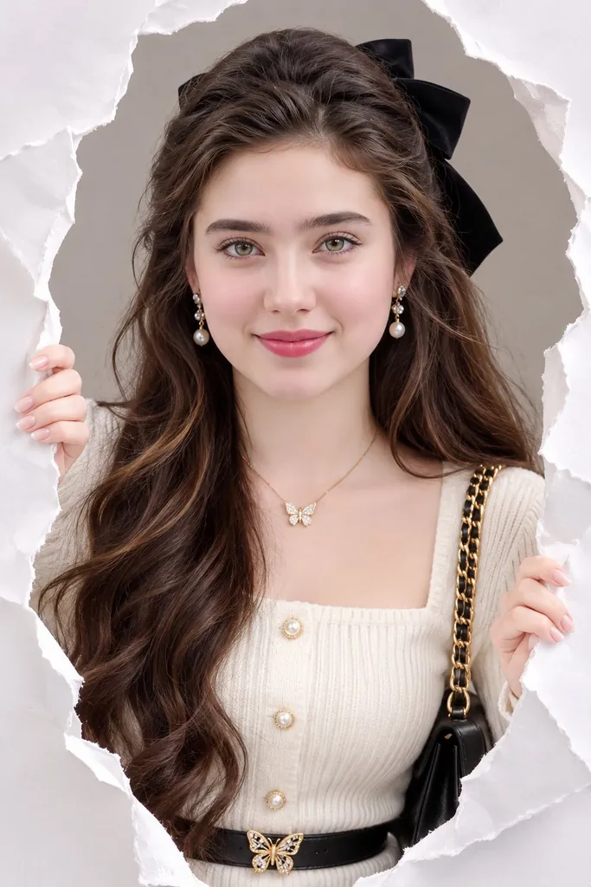

# Portrait Through a Torn Paper Wall — by @HaniaAi12

[← Back to Community Examples](../../EXAMPLES.md) · Category: Photography · Model: `GPT Image 2`

<a href="https://x.com/HaniaAi12/status/2122886883994746946"></a>

Source: **[@HaniaAi12 on X](https://x.com/HaniaAi12/status/2122886883994746946)** · Creator: [Hania Ai](https://x.com/HaniaAi12)

## Prompt

```text
Create an ultra-realistic, high-end fashion portrait of a beautiful young woman smiling warmly at the camera, emerging through a large, irregularly torn opening in a white paper wall. She has long, voluminous, naturally wavy dark-brown hair with subtle caramel highlights, center-parted front strands, soft facial features, expressive hazel-brown eyes, natural rosy makeup, and a bright, charming smile.

She is wearing a fitted ivory-white ribbed knit cardigan with a square neckline and delicate buttons, paired with a black belt featuring an elegant gold butterfly buckle. Add small pearl drop earrings, a delicate butterfly pendant necklace, and a stylish black shoulder bag with a gold chain strap. A large black ribbon is tied into her hair.

Her hands gently hold the torn paper edges, creating a creative 3D pop-out effect. The ripped white paper has realistic fibers, natural folds, and soft shadows, with a warm light-gray background visible through the opening.

Photography style: luxury fashion editorial, photorealistic skin texture, detailed hair strands, realistic fabric texture, soft studio lighting, natural facial proportions, elegant composition, sharp focus, professional DSLR photography, 85mm portrait lens, premium color grading, high detail, 4:5 vertical composition.

Negative prompt: cartoon, anime, CGI, plastic skin, blurry face, distorted hands, extra fingers, extra limbs, duplicate person, unnatural smile, asymmetrical eyes, unrealistic hair, bad anatomy, low resolution, text, watermark.
```

## Try it

Paste the prompt into **[vinano.ai](https://vinano.ai?utm_source=github&utm_medium=readme&utm_campaign=awesome-image-video-prompts-updating&utm_content=x-page-try)** to generate your own version.

> The image and prompt belong to @HaniaAi12 ([original post](https://x.com/HaniaAi12/status/2122886883994746946)) and are shown here with credit for reference. Creators can ask for changes or removal by opening an issue.
