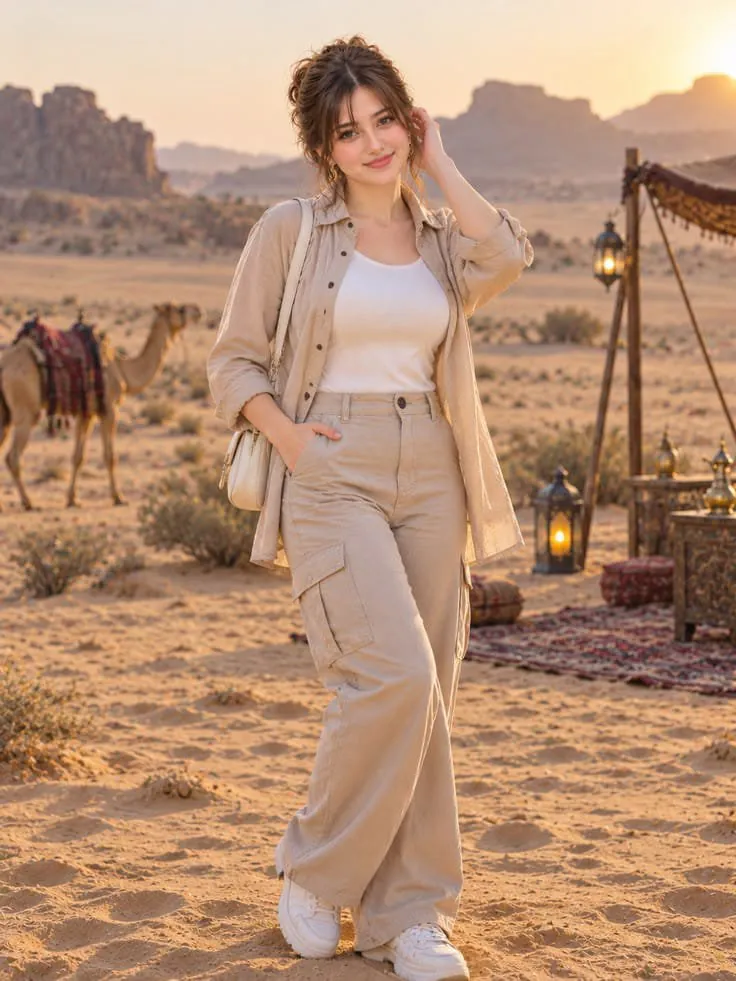

# Wadi Rum Desert Travel Portrait — by @AIwithRubii

[← Back to Community Examples](../../EXAMPLES.md) · Category: Photography · Model: `GPT Image`

<a href="https://x.com/AIwithRubii/status/2121522846048678162"></a>

Source: **[@AIwithRubii on X](https://x.com/AIwithRubii/status/2121522846048678162)** · Creator: [Rubi](https://x.com/AIwithRubii)

## Prompt

```text
A stunning photorealistic full-body travel portrait of a beautiful young woman standing in the golden desert of Wadi Rum, Jordan, during sunset. She wears a stylish beige oversized button-up shirt, white fitted tank top, beige cargo pants, and clean white sneakers. A small cream shoulder bag hangs from her shoulder. Her brunette hair is styled in a messy elegant bun with soft face-framing bangs. One hand gently touches her hair while the other rests casually in her pocket. A camel stands in the background, with traditional Bedouin decorations, glowing lanterns, Persian rugs, and dramatic sandstone mountains. Warm golden-hour sunlight, natural skin texture, realistic facial features, soft cinematic shadows, luxury travel photography, editorial fashion photography, 85mm lens, shallow depth of field, ultra-detailed, 4K, natural colors, vertical 9:16 composition. No text, no watermark, no logo.
```

## Try it

Paste the prompt into **[vinano.ai](https://vinano.ai?utm_source=github&utm_medium=readme&utm_campaign=awesome-image-video-prompts-updating&utm_content=x-page-try)** to generate your own version.

> The image and prompt belong to @AIwithRubii ([original post](https://x.com/AIwithRubii/status/2121522846048678162)) and are shown here with credit for reference. Creators can ask for changes or removal by opening an issue.
